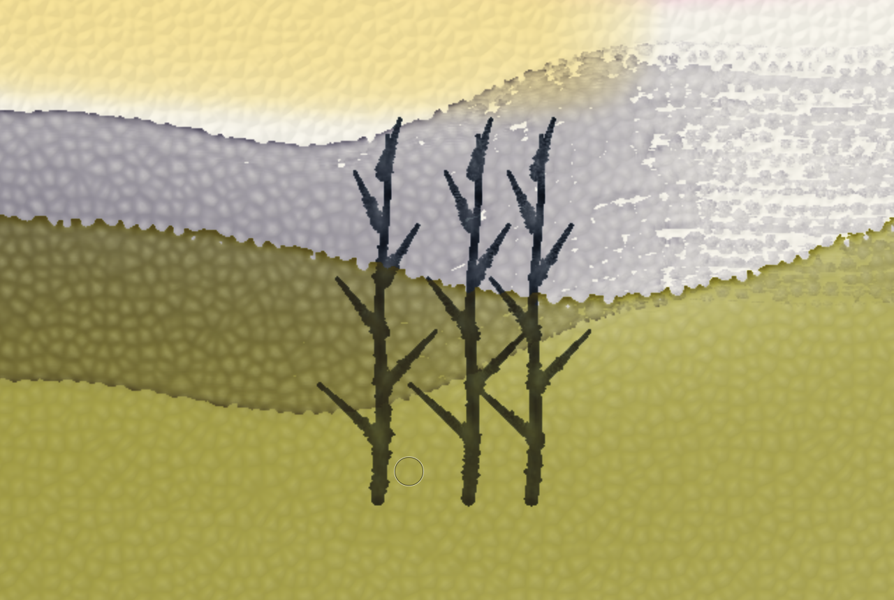

# Aquarelle

Watercolour painting in the browser, built on a fluid simulation rather than textured
stamps. Paint is pigment carried by water: it flows while the paper is wet, blooms when
you drop wet into wet, darkens at the edges as it dries, settles into the paper's tooth,
and glazes over dried layers. Made for Apple Pencil / stylus first; finger and mouse work too.
No backend, no build step, no dependencies: plain ES modules and WebGL2. Installable PWA,
works offline.


```
python3 -m http.server      # any static server (the service worker needs https or localhost)
bun test                    # pigment optics, mixing, stroke resampling, paper: 10 tests
node smoke.js               # headless Chromium (SwiftShader), real pen/touch/mouse events: 26 checks + screenshots
                            # SKIP_SCENE=1 skips painting the landscape; PORT= / CDP= / CHROME= to override
```

## Using it

| Input | Does |
|---|---|
| Pencil / stylus | paints. Pressure sets size and load, tilt lays the brush on its side (wider, elliptical footprint). Hover shows the brush outline |
| Finger | paints until a pen has been used, then navigates (Menu → Fingers with a pen) |
| Two fingers | pan, pinch-zoom, twist to rotate (snaps back to square). Two-finger tap: undo, three-finger tap: redo |
| Long-press / Alt-click / I | pick a colour off the painting as a new pigment |
| Mouse | left paints (speed stands in for pressure: slow is heavier), middle/right or Space-drag pans, wheel zooms |
| Keys | B W R Y S brushes, Q clear water, L lift, E erase, `[` `]` size, 1–9 pigments (Shift adds to the mix), F dry now, ⌘Z / ⇧⌘Z, 0 fit, Tab hide UI, ? help |

Brushes: Round (pressure makes it fat), Wash (big mop), Detail (rigger), Dry brush (thick
paint, little water: only the paper's peaks take it, in streaks), Splatter. Tools: clear
water (wet the paper first for wet-in-wet, or soften an edge), Lift (damp brush; granulating
pigments lift easily, staining ones barely), Eraser. Three sliders per brush: size, water,
paint. With "brush runs dry" on, a stroke empties as it goes, so long strokes break up
into drybrush at the end like a real brush.

19 pigments, each with its own masstone, transparency, granulation and staining (Hansa
Yellow, New Gamboge, Yellow Ochre, Pyrrole Orange, Cadmium Red, Quinacridone Rose,
Dioxazine Violet, French Ultramarine, Cerulean, Phthalo Blue/Green, Hooker's and Sap Green,
Burnt Sienna/Umber, Indian Red, Payne's Grey, Potter's Pink, Titanium White) plus custom
colours. Tap + Mix (or Shift / long-press a well) to load up to four pigments on the brush.
Three papers (cold press, rough, hot press), five paper tints, three sheet sizes,
portrait/landscape. Hair dryer button: hold to dry faster, double-tap to dry at once.
Tilt button: board tilted (wet paint runs down) or, on a tablet, follow the device's tilt.
Undo is 1:1 with strokes, including everything the water did afterwards. The painting
autosaves to IndexedDB once dry; PNG export at sheet resolution (share sheet on iPad).



## How it works

**State** (RGBA16F textures at sheet resolution, ping-ponged): water standing on the paper
and water held in the paper; suspended pigment as Kubelka-Munk absorption K (rgb) and
scattering S (rgb) amounts, plus granulation and liftability carried as mass-weighted
channels; the same for pigment deposited in the paper; pipe-model outflow fluxes.

**Each substep** (180 Hz, fixed for stability; slow processes scale with real time so
drying takes the same seconds on a slow GPU) is three fragment passes, scissored to the
rectangle that is actually wet — a dry sheet costs nothing, and a stroke costs only its
neighbourhood. An async readback every 0.4 s of a 48×48 wet map shrinks or grows that
rectangle (`fenceSync`, no stalls).

1. **Flux** — virtual-pipe shallow water (O'Brien & Hodgins 1995, as used by Mei, Decaudin
   & Hu 2007): outflow to the four neighbours driven by the difference in water surface,
   damped, plus gravity when the board is tilted. Surface tension pins the contact line:
   water only advances onto dry paper when it stands deep enough, and more easily into the
   paper's valleys, so edges come out irregular. Onto damp paper it creeps (capillary
   flow), which is what makes backruns and cauliflowers.
2. **Water** — apply fluxes; pigment moves with exactly the fraction of water that moves,
   so it is conserved. Small diffusion inside connected water (wet-in-wet softness).
   Absorption into the paper and diffusion inside it. Evaporation, faster at the rim of a
   wet area — that pulls water and pigment outward and gives edge darkening, the
   "coffee ring" of Deegan et al. 1997, modelled the way Curtis et al. 1997 do. Brush
   stamps are applied here: the brush tops water up to its load, adds pigment with the
   water, and exchanges paint with the wash it touches.
3. **Transfer** — Curtis et al.'s adsorption/desorption between water and paper:
   granulating pigment settles into the valleys of the paper, liftable pigment comes back
   off the peaks under water, staining pigment stays put; whatever is still suspended
   drops out when the water is gone. Lift and erase act here.

**Rendering** composites deposited + suspended pigment over the lit paper with the
Kubelka-Munk two-flux model (reflectance and transmittance of a layer, then layer over
background), four taps averaged in reflectance when zoomed out. Wet areas are darker and
more saturated with a specular sheen from the water surface. Paper relief is lit from
the upper left. Because pigment lives as K and S amounts, mixing on the brush, mixing on
the paper and glazing a dry layer all behave subtractively: ultramarine over gamboge is
green, three glazes get deeper rather than greyer.

**Pigments** are specified as the colour of a unit-thickness layer over white and over
black, inverted to K and S per channel (Curtis et al. 1997 §5.1) in linear light, so
transparency is a property of the pigment: Cadmium Red covers a dark underlayer, Rose
glows through it.

**Paper** is a tileable procedural height field (`paper.js`): soft Worley cells for the
felt texture of mould-made paper, fBm mottling and short fibres. It drives everything:
lighting, where water advances first, how much water a pixel holds, granulation, dry
brush and the roughness of stroke edges. Rough has bigger, deeper cells; hot press is
nearly flat.

**Input** uses Pointer Events with `getCoalescedEvents()` for full-rate Pencil samples,
pressure and `altitudeAngle`/`azimuthAngle` (or `tiltX/Y`), resampled at a fixed spacing
with a speed-adaptive smoother. Stamps of a frame are batched (48 per draw) so a 240 Hz
Pencil costs a couple of substeps per frame, not one per event. Palm rejection is by
pointer type: once a pen has been seen, fingers navigate. A one-finger touch waits up to
90 ms (or 8 px) to see if it is the start of a pinch; a stroke that turns out to be one
is withdrawn without touching redo.

**Undo** copies the 128 px tiles a stroke can touch into a GPU atlas before the stroke
(and any tiles the spreading water reaches later), so undo restores the sheet including
everything the water did afterwards; ~1.15 sheets of tiles, oldest steps evicted.

**Saving** sums deposited and suspended pigment into two half-float layers and stores
them gzip-compressed (`CompressionStream`) in IndexedDB once the sheet is dry, and when the
page is hidden.

## Research notes

### Apps (as of Oct 2026)

- **Rebelle** (Escape Motions, Slovakia; 1.0 in May 2015, Rebelle 8 Oct 2025, 8.3 Aug 2026)
  is the reference for simulated watercolour on the desktop: fluid flow, pigment mixing,
  wet/dry layers, tilt-the-canvas drips, "MotionIO" for driving the engine from animation.
  Windows/macOS only; no iPad version.
- **Expresii** (Nelson Chu, formerly HKUST, MSR and Adobe; SIGGRAPH 2017 Appy Hour, 1.0 in
  2016) is the CFD-based ink and watercolour engine descended from his MoXi research
  (Chu & Tai, "MoXi: Real-time ink dispersion in absorbent paper", SIGGRAPH 2005),
  strongest for East Asian brush-and-ink; hybrid vector-raster output at 12k+. Windows only.
- **Adobe Fresco** (2019, iPad first) has "Live Brushes": physics-driven watercolour and
  oil in a pixel simulation, the main mainstream iPad option with real flow.
- **ArtRage** / **ArtRage Vitae** (Ambient Design) — long-running natural-media painter on
  iPad with blending oils and watercolour.
- **MignonSketch** (Renshi Asada, App Store 2026, Metal GPU engine) — very new and very
  close to this project in spirit: water and pigment tracked separately, backruns,
  pigment-like mixing, re-wetting dried paint, gravity from device tilt, 28 papers.
- **Procreate** — the best-selling iPad painting app, but its watercolour is stamp-based
  brushes with "wet mix"; no fluid. Same for most others: **Tayasui Watercolor**,
  **Clip Studio**, **Krita**, **Corel Painter** (Painter's "Real Watercolor" since 2017 does
  simulate flow on the desktop).

What the good ones share and this project copies: separate water and pigment, layers
that are either wet (mixing) or dry (glazing), drying you can see and speed up, paper
that matters, Pencil pressure and tilt, and gestures that keep the canvas uncluttered
(two-finger tap undo comes from Procreate and is now expected on iPad).

### Algorithms

- **Curtis, Anderson, Seims, Fleischer, Salesin, "Computer-Generated Watercolor"**,
  SIGGRAPH 1997 — the foundation: shallow-water layer, pigment deposition layer,
  capillary layer; edge darkening by removing water near the rim of the wet mask;
  backruns via capillary diffusion; granulation and staining per pigment; Kubelka-Munk
  glazing with K and S from "unit layer over white / black". Used here almost literally
  for the transfer step, the optics and the pigment specification.
- **Van Laerhoven & Van Reeth, "Real-time simulation of watery paint"**, CAVW 2005 (and
  the SIGGRAPH 2005 talk on thin paint media) — Stam's stable fluids on the GPU with
  Curtis-style deposition and KM, interactive.
- **Chu & Tai, MoXi**, SIGGRAPH 2005 — lattice Boltzmann ink flow in absorbent paper,
  the basis of Expresii; best for ink, heavier than needed here.
- **O'Brien & Hodgins 1995 / Mei, Decaudin & Hu 2007, "Fast hydraulic erosion simulation
  on GPU"** — the virtual-pipe shallow-water model: four flux values per cell, fully
  parallel, unconditionally mass-conserving with a simple scaling. Cheaper and more
  controllable than Navier-Stokes for a film of water a pixel deep; used for the flow.
- **Deegan et al., "Capillary flow as the cause of ring stains from dried liquid drops"**,
  Nature 1997 — why edges darken.
- **Kubelka & Munk 1931**; **Haase & Meyer 1992**, "Modeling pigmented materials for
  realistic image synthesis" — two-flux layer optics and K/S mixing.
- **Sochorová & Jamriška, "Practical Pigment Mixing for Digital Painting"** (Mixbox),
  SIGGRAPH Asia 2021 — RGB in, RGB out via a latent KM space with real measured pigments.
  Lovely for RGB-only engines, but CC BY-NC; here the simulation already carries K and S,
  so mixing is physically consistent without it.
- **Montesdeoca et al., "MNPR"** (2017-2018) and Bousseau et al. 2006 — image-space
  watercolour stylisation for 3D/video; useful for the look (pigment turbulence, edge
  darkening, paper granulation) but not interactive painting.
- **TU Delft 2025 thesis "Dynamic Watercolour Painting on 3D Surfaces"** — the same
  Curtis-style model moved onto meshes, a sign the 1997 model is still the one people build on.

### Decisions and trade-offs

- **Pipe model over stable fluids**: a watercolour wash is a very thin film; momentum
  matters a little (blooms push outward) but advection and surface tension at the edge
  matter more. The pipe model gives exact mass conservation of water and pigment, which
  stops colour from fading or appearing out of nowhere over long drying times.
- **Three RGB channels** for K/S rather than spectral: 3 channels are enough for the
  classic mixtures (blue + yellow = green, ultramarine + rose = violet, complementary
  mixes grey) and keep everything in two RGBA16F textures.
- **One layer**, not a layer stack: glazing comes from the physics (dried pigment is in the
  deposit layer, new wet pigment sits on top in the same KM composite). This is how real
  watercolour works and keeps the UI to "paint".
- **Active rectangle + async probe** keeps an iPad at 120 Hz while one stroke is wet and
  costs nothing once everything has dried.
- **Requires WebGL2 with float render targets** (all current iPads / iPhones in Safari,
  Chrome, Firefox).

Not done: brush bristle simulation, layers, masking fluid, salt, time-lapse. Re-wetting is
only partial: liftable pigment desorbs under new water, staining pigment does not.
