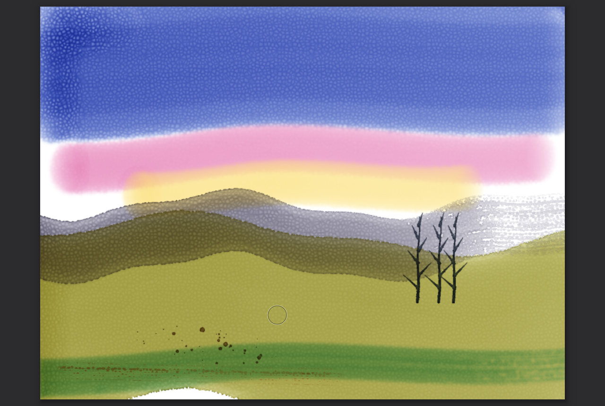
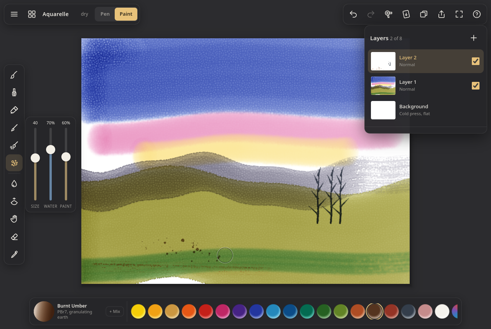

# Aquarelle

Watercolour painting in the browser, built on a fluid simulation rather than textured
stamps. Paint is pigment carried by water: it flows while
the paper is wet, blooms when you drop wet into wet, darkens at the edges as it dries,
settles into the paper's tooth, and glazes over dried layers. Made for Apple Pencil /
stylus first; finger and mouse work too. No backend, no build step, no dependencies: plain
ES modules and WebGL2. Installable PWA, works offline.



[`v1/`](v1/) is the first build of this interface (before layers, gallery and pen mode), kept for comparison; it stores its painting separately.

```
python3 -m http.server      # any static server (the service worker needs https or localhost)
bun test                    # pigment optics, mixing, stroke resampling, paper: 10 tests
node smoke.js               # headless Chromium (SwiftShader), real pen/touch/mouse events through the UI: 65 checks + screenshots
                            # SKIP_SCENE=1 skips painting the landscape; PORT= / CDP= / CHROME= to override
```

## Using it



The interface is the first one's floating toolbars, with everything added since.

- **Left:** one button per brush (Round, Wash, Flat, Rigger, Dry brush, Splatter, Clear
  water, Lift), then Smudge, Eraser and the eyedropper. Tap the selected brush again for
  its settings (size, water, paint, pressure → size / paint, spacing, reset); tap Smudge
  or Eraser again to choose the brush shape they use.
- **Beside the brushes:** Size, Water and Paint sliders with their values on top (on a
  phone or a 7" e-reader they sit on the right). They drag relative to where you touch,
  finer when you drag sideways. For Lift, Smudge and Eraser the Paint slider is their
  strength.
- **Bottom:** the watercolour palette. The big well shows what is on the brush, from a thin
  wash to a full load; tap it, or the rainbow well at the end, for the colour wheel.
  Tap a pigment to load it; + Mix (or long-press / Shift-click a well) adds pigments to the
  brush.
- **Top left:** menu (share, canvas, video, preferences, help), gallery, the wet dot (it
  pulses while the sheet is wet) and **Pen | Paint**.
- **Top right:** undo, redo, hair dryer (hold to dry faster, double-tap to dry at once),
  tilt the board, layers, share, full screen, help.

The sheet is fitted into the space the panels leave, so no part of it is under a toolbar.
Right-hand interface (Prefs) mirrors the brushes and sliders.

| Input | Does |
|---|---|
| Pencil / stylus | paints. Pressure sets size and load (pressure curve in Prefs), tilt lays the brush on its side. Hover shows the brush outline |
| Finger | paints until a pen has been used, then navigates (Prefs → Fingers) |
| Two fingers | pan, pinch-zoom, twist to rotate (snaps square); a quick pinch in fits the canvas |
| Two / three / four-finger tap | undo / redo / hide the toolbars |
| Touch and hold | eyedropper (also the dropper at the bottom of the brushes, Alt-click or I) |
| Hold at the end of a stroke | QuickShape: the stroke is taken back, with everything its water did, and painted again as a straight line or an ellipse (circle when nearly round) |
| Mouse | left paints (speed stands in for pressure), middle/right or Space-drag pans, wheel zooms |
| Keys | B W T R Y X brushes, Q water, K lift, P pen / paint, S smudge, E erase, L layers, C colours, I eyedropper, `[` `]` size, 1–9 pigments (Shift adds to the mix), F dry now, ⌘Z / ⇧⌘Z, 0 fit, Tab hide UI |

**Pen mode** (Pen | Paint at the top left, or P) is for writing notes. Ink goes straight into
the page with a crisp edge and no water, so it is dry the moment you lift the pen and
never bleeds into wet paint. Nibs along the bottom: Ballpoint, Fineliner (constant width),
Brush pen (hairline to bold with pressure), Highlighter (transparent chisel, writing under
it stays readable) and Eraser, in a pen bar that replaces the palette; the brushes and the
water / paint sliders step aside, leaving size. The
stylus's eraser end erases in either mode. Gallery → + → Notebook page makes a 1264 × 1680
page (the B7 Pro's own resolution) with lined or grid ruling; any canvas can take lined,
grid or dotted ruling under Actions → Canvas → Page ruling. Ink and watercolour share
layers and undo, so notes can be painted over and the other way round.

**Choosing colours.** In paint mode, tap a pigment in the palette along the bottom; the
big well or the rainbow well opens the colour wheel. In pen mode, tap a swatch in the pen
bar (ten inks picked to stay distinct on colour e-paper, six highlighter colours when the
highlighter is selected) or + for the wheel: drag the outer ring for the hue, inside for
the shade (left greyer, right purer, up lighter, down darker). Colours you write with are
added to the bar. Touch and hold the page (or the dropper) to pick a colour off it.

**E-paper screens** (Bigme B7 Pro: 7" Kaleido colour, 1264 × 1680 at 300 ppi black and
white / 150 ppi colour, capacitive pen with pressure, Android 14) get a light, high-contrast
theme: white bars, black 2 px outlines, black for "selected", no shadows, transitions or
animated indicators, and a drying wash is redrawn a few times a second instead of every
frame so the panel flashes less. It switches on by itself for Bigme / Boox / Kobo /
PocketBook user agents and can be toggled in Actions → Prefs → E-paper display (or with
`?eink=1`). The layout was checked at the B7 Pro's CSS size (632 × 840 at 2×): the page
fits between the top bar and the pen bar and every control is at least 30 CSS px (about
5 mm). On Android the low-latency canvas mode is off, because it can put the canvas on a
hardware overlay plane that e-paper drivers handle badly. For the snappiest pen, set the
B7 Pro's per-app refresh mode for the browser to its fast mode in the Bigme E-Ink centre.

**Full screen.** The corners button in the top bar goes full screen (Fullscreen API: Android
Chrome, desktop, Safari); Prefs → Full screen on first touch does it with the first tap (on
by default on Android tablets and phones; a browser only allows it from a tap). Added to the
home screen, the app opens full screen by itself.

**Brushes**: Flat has a chisel edge held at a fixed angle; Clear water wets the paper or
softens an edge, Lift blots paint back off. Smudge and erase borrow the shape of any
watercolour brush. Smudge drags
wet paint along the stroke and pushes dried paint around more gently (liftable pigments
move more). With "brush runs dry" on, a stroke empties as it goes.

**Colours**: a colour wheel (hue ring, saturation × brightness inside) whose picks
become custom pigments with an adjustable opacity (glassy to body colour) and granulation,
the palette of 19 artist pigments (Hansa Yellow, New Gamboge, Yellow Ochre, Pyrrole Orange,
Cadmium Red, Quinacridone Rose, Dioxazine Violet, French Ultramarine, Cerulean, Phthalo
Blue/Green, Hooker's and Sap Green, Burnt Sienna/Umber, Indian Red, Payne's Grey, Potter's
Pink, Titanium White) with + Mix to load up to four on the brush, and a row of recent colours.

**Layers**: add, select, hide, opacity, rename, clear, duplicate, merge down, move,
delete — all undoable, in the same history as strokes. The paper is the background layer.
Only the active layer is ever wet (switching layers dries the one you leave); layers are
composited over each other with Kubelka-Munk, so a layer glazes like a dried wash. The
layer count is capped by canvas size (about 256 MB of layer textures: 8 at 1600 × 1200).

**Time-lapse**: while you paint, small JPEG frames are read back asynchronously (at most
about two a second, only when something changed, thinned out past 1800 frames) and stored
with the painting. Replay with a scrubber, export 30 s or full length as MP4 (Safari) or
WebM via MediaRecorder.

Everything autosaves to IndexedDB once the sheet is dry, and when the page is hidden.
The paper is plain white with no visible texture by default; Canvas → Show paper texture
draws the relief (the grain drives the physics either way: granulation, edges, dry brush).

## How it works

**State** (RGBA16F textures at sheet resolution, ping-ponged): water standing on the paper
and water held in the paper; suspended pigment as Kubelka-Munk absorption K (rgb) and
scattering S (rgb) amounts, plus granulation and liftability carried as mass-weighted
channels; the same for pigment deposited in the paper; pipe-model outflow fluxes.

**Each substep** (180 Hz; when frames run long it takes fewer per frame — flow stays at
its stable per-substep rate, drying scales with real time) is three fragment passes,
scissored to the rectangle that is actually wet — a dry sheet costs nothing, and a stroke
costs only its neighbourhood. An async readback every 0.4 s of a 48×48 wet map shrinks or
grows that rectangle (`fenceSync`, no stalls). Brush stamps are separate passes scissored
to each batch's footprint, so every pointer sample of a frame goes down at once without
extra substeps.

1. **Flux** — virtual-pipe shallow water (O'Brien & Hodgins 1995, as used by Mei, Decaudin
   & Hu 2007): outflow to the four neighbours driven by the difference in water surface,
   damped, plus gravity when the board is tilted. Surface tension pins the contact line:
   water only advances onto dry paper when it stands deep enough, and more easily into the
   paper's valleys, so edges come out irregular. Onto damp paper it creeps (capillary
   flow), which is what makes backruns and cauliflowers.
2. **Water** — apply fluxes; pigment moves with exactly the fraction of water that moves,
   so it is conserved. Small diffusion inside connected water (wet-in-wet softness).
   Absorption into the paper and diffusion inside it. Evaporation, faster at the rim of a
   wet area — that pulls water and pigment outward and gives edge darkening, the
   "coffee ring" of Deegan et al. 1997, modelled the way Curtis et al. 1997 do. Brush
   stamps (their own pass) top water up to the brush's load, add pigment with the water,
   and exchange paint with the wash they touch.
3. **Transfer** — Curtis et al.'s adsorption/desorption between water and paper:
   granulating pigment settles into the valleys of the paper, liftable pigment comes back
   off the peaks under water, staining pigment stays put; whatever is still suspended
   drops out when the water is gone. Lift and erase act here.

**Rendering** composites each layer's pigment over what lies below it (the paper colour,
then the layers underneath) with the Kubelka-Munk two-flux model (reflectance and
transmittance of a layer, then layer over background) into an sRGB texture, updated only
over the wet rectangle. Wet areas are darker and more saturated with a specular sheen from
the water surface. The per-frame screen pass is then one or four texture reads plus a
precomputed paper-relief tile, so panning, zooming and a drying wash stay cheap at retina
resolution. Because pigment lives as K and S amounts, mixing on the brush, mixing on
the paper and glazing a dry layer all behave subtractively: ultramarine over gamboge is
green, three glazes get deeper rather than greyer.

**Pigments** are specified as the colour of a unit-thickness layer over white and over
black, inverted to K and S per channel (Curtis et al. 1997 §5.1) in linear light, so
transparency is a property of the pigment: Cadmium Red covers a dark underlayer, Rose
glows through it.

**Paper** is a tileable procedural height field (`paper.js`): soft Worley cells for the
felt texture of mould-made paper, fBm mottling and short fibres. It drives everything:
lighting, where water advances first, how much water a pixel holds, granulation, dry
brush and the roughness of stroke edges. Rough has bigger, deeper cells; hot press is
nearly flat.

**Pen alignment.** The canvas is sized and mapped from its measured box, not from
`100vh` / `innerHeight`. On Chrome for Android `100vh` is the height with the address bar
hidden, so while the bar showed, the picture was stretched vertically and paint landed
below the pen (26 px at the top of a 7" screen, 84 px at the bottom). A resize during a
stroke (address bar, entering full screen) leaves the page where it is until the pen lifts.
The smoke test reads the pixels on screen under a pen tap with the canvas box taller than
the window and checks the paint is within 3 px of the pen.

**Input** uses Pointer Events with `getCoalescedEvents()` for full-rate Pencil samples,
pressure and `altitudeAngle`/`azimuthAngle` (or `tiltX/Y`), resampled at a fixed spacing
with a speed-adaptive smoother. Stamps of a frame are batched (48 per draw) so a 240 Hz
Pencil costs a couple of substeps per frame, not one per event. Palm rejection is by
pointer type: once a pen has been seen, fingers navigate. A one-finger touch waits up to
90 ms (or 8 px) to see if it is the start of a pinch; a stroke that turns out to be one
is withdrawn without touching redo.

**Undo** copies the 128 px tiles a stroke can touch into a GPU atlas before the stroke
(and any tiles the spreading water reaches later), so undo restores the sheet including
everything the water did afterwards; ~1.15 sheets of tiles, oldest steps evicted. Layer
operations are entries in the same history that keep what they need to reverse themselves.

**Memory**: water and suspended pigment exist once; each layer owns one K and one S
half-float texture, and the active layer borrows two shared scratch textures as its
ping-pong partners, copied home when it stops being active.

**Saving** reads each layer's pigment back through pixel-pack buffers and a fence (no
main-thread stall), converts to half floats (`Float16Array` where available) and stores
it gzip-compressed (`CompressionStream`) in IndexedDB with a JPEG thumbnail.

## Research notes

### Apps (as of Oct 2026)

- **Rebelle** (Escape Motions, Slovakia; 1.0 in May 2015, Rebelle 8 Oct 2025, 8.3 Aug 2026)
  is the reference for simulated watercolour on the desktop: fluid flow, pigment mixing,
  wet/dry layers, tilt-the-canvas drips, "MotionIO" for driving the engine from animation.
  Windows/macOS only; no iPad version.
- **Expresii** (Nelson Chu, formerly HKUST, MSR and Adobe; SIGGRAPH 2017 Appy Hour, 1.0 in
  2016) is the CFD-based ink and watercolour engine descended from his MoXi research
  (Chu & Tai, "MoXi: Real-time ink dispersion in absorbent paper", SIGGRAPH 2005),
  strongest for East Asian brush-and-ink; hybrid vector-raster output at 12k+. Windows only.
- **Adobe Fresco** (2019, iPad first) has "Live Brushes": physics-driven watercolour and
  oil in a pixel simulation, the main mainstream iPad option with real flow.
- **ArtRage** / **ArtRage Vitae** (Ambient Design) — long-running natural-media painter on
  iPad with blending oils and watercolour.
- **MignonSketch** (Renshi Asada, App Store 2026, Metal GPU engine) — very new and very
  close to this project in spirit: water and pigment tracked separately, backruns,
  pigment-like mixing, re-wetting dried paint, gravity from device tilt, 28 papers.
- **Procreate** — the best-selling iPad painting app, but its watercolour is stamp-based
  brushes with "wet mix"; no fluid. Its interface is the one iPad painters know (gallery,
  tool row, size / opacity sidebar, finger-tap undo, QuickShape, time-lapse); Aquarelle
  borrows its gestures, gallery, layers, QuickShape and time-lapse, but keeps its own
  floating toolbars and a pigment palette along the bottom. Same for most others: **Tayasui Watercolor**,
  **Clip Studio**, **Krita**, **Corel Painter** (Painter's "Real Watercolor" since 2017 does
  simulate flow on the desktop).

What the good ones share and this project copies: separate water and pigment, layers
that are either wet (mixing) or dry (glazing), drying you can see and speed up, paper
that matters, Pencil pressure and tilt, and gestures that keep the canvas uncluttered
(two-finger tap undo comes from Procreate and is now expected on iPad).

### Algorithms

- **Curtis, Anderson, Seims, Fleischer, Salesin, "Computer-Generated Watercolor"**,
  SIGGRAPH 1997 — the foundation: shallow-water layer, pigment deposition layer,
  capillary layer; edge darkening by removing water near the rim of the wet mask;
  backruns via capillary diffusion; granulation and staining per pigment; Kubelka-Munk
  glazing with K and S from "unit layer over white / black". Used here almost literally
  for the transfer step, the optics and the pigment specification.
- **Van Laerhoven & Van Reeth, "Real-time simulation of watery paint"**, CAVW 2005 (and
  the SIGGRAPH 2005 talk on thin paint media) — Stam's stable fluids on the GPU with
  Curtis-style deposition and KM, interactive.
- **Chu & Tai, MoXi**, SIGGRAPH 2005 — lattice Boltzmann ink flow in absorbent paper,
  the basis of Expresii; best for ink, heavier than needed here.
- **O'Brien & Hodgins 1995 / Mei, Decaudin & Hu 2007, "Fast hydraulic erosion simulation
  on GPU"** — the virtual-pipe shallow-water model: four flux values per cell, fully
  parallel, unconditionally mass-conserving with a simple scaling. Cheaper and more
  controllable than Navier-Stokes for a film of water a pixel deep; used for the flow.
- **Deegan et al., "Capillary flow as the cause of ring stains from dried liquid drops"**,
  Nature 1997 — why edges darken.
- **Kubelka & Munk 1931**; **Haase & Meyer 1992**, "Modeling pigmented materials for
  realistic image synthesis" — two-flux layer optics and K/S mixing.
- **Sochorová & Jamriška, "Practical Pigment Mixing for Digital Painting"** (Mixbox),
  SIGGRAPH Asia 2021 — RGB in, RGB out via a latent KM space with real measured pigments.
  Lovely for RGB-only engines, but CC BY-NC; here the simulation already carries K and S,
  so mixing is physically consistent without it.
- **Montesdeoca et al., "MNPR"** (2017-2018) and Bousseau et al. 2006 — image-space
  watercolour stylisation for 3D/video; useful for the look (pigment turbulence, edge
  darkening, paper granulation) but not interactive painting.
- **TU Delft 2025 thesis "Dynamic Watercolour Painting on 3D Surfaces"** — the same
  Curtis-style model moved onto meshes, a sign the 1997 model is still the one people build on.

### Decisions and trade-offs

- **Pipe model over stable fluids**: a watercolour wash is a very thin film; momentum
  matters a little (blooms push outward) but advection and surface tension at the edge
  matter more. The pipe model gives exact mass conservation of water and pigment, which
  stops colour from fading or appearing out of nowhere over long drying times.
- **Three RGB channels** for K/S rather than spectral: 3 channels are enough for the
  classic mixtures (blue + yellow = green, ultramarine + rose = violet, complementary
  mixes grey) and keep everything in two RGBA16F textures.
- **Layers glaze**: within a layer, glazing comes from the physics (dried pigment in the
  deposit layer, new wet pigment on top in the same KM composite); between layers the same
  KM compositing applies, so layers behave like separately dried washes.
- **Active rectangle + async probe** keeps an iPad at 120 Hz while one stroke is wet and
  costs nothing once everything has dried.
- **Requires WebGL2 with float render targets** (all current iPads / iPhones in Safari,
  Chrome, Firefox).

Not done: brush bristle simulation, selections and transform, masking fluid, salt, blend
modes other than glazing. Re-wetting is only partial: liftable pigment desorbs under new
water, staining pigment does not.
