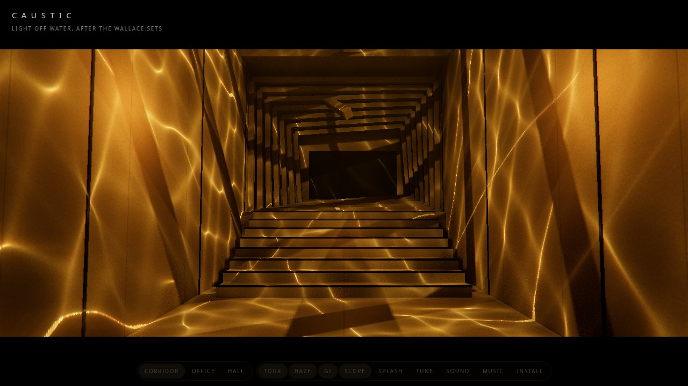
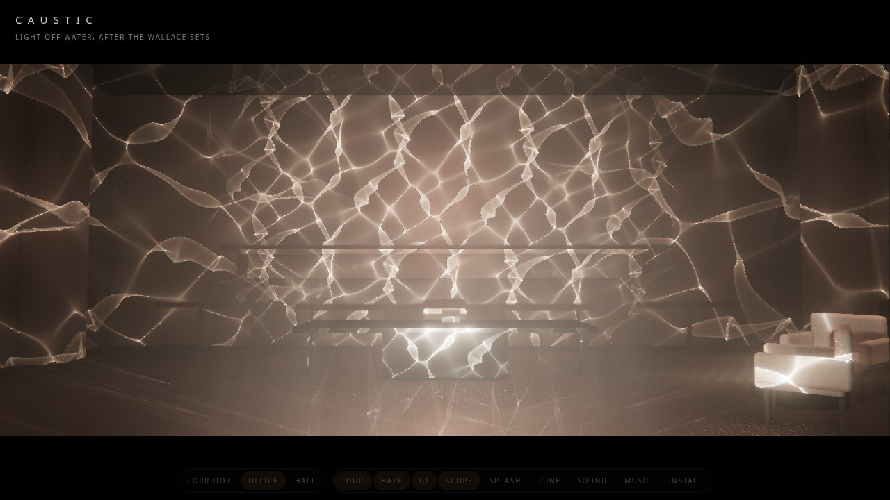

# Caustic: lighting the Wallace sets with light off water

The Wallace building in *Blade Runner 2049* is lit almost entirely by moving reflections of water: thin bright lines crawling down a planked corridor, broad gold ribbons over Wallace's concrete office, fine ripples on the walls of a flooded hall. This sketch rebuilds those three sets in three.js r187 with WebGPU and TSL, and copies how they were lit rather than simulating the physics. It lives in [vibes/caustic](./).

## How the film did it

Roger Deakins didn't add the ripples in post. His crew built shallow troughs of water on the set and aimed big tungsten lamps into them (eight 10K Fresnels with custom barn doors, by his own forum and the production write-ups), so the reflections off the moving water landed on the walls. That gives a plan that is cheap on a GPU:

1. make the light pattern a rippling surface throws (a caustic) as a texture;
2. project it from a lamp, the way a slide projector would, with shadows;
3. let the room's materials, bounce light, haze and the lens do the rest.

## Water you can place

The first version drew one tileable caustic texture per set and repeated it across each lamp's beam. It looked like wallpaper: the same tile three or four times on a wall, every cell the same size near and far, the lines equally sharp everywhere, and a round beam that didn't come out of anything. Real water light has a source. It fans out of the trough's shape, the cells stretch along the throw, and the lines sharpen with distance from the water.

So each lamp now has its own water, a real rectangle in the set (`Trough` in `caustics.js`):

- **Corridor:** three lamps high outside shine down through glass tanks of water over the open roof (refraction).
- **Office:** three low lamps shine down into troughs on the floor along the front wall, which throw their reflections up over the walls and ceiling, and a lamp over the skylight shines down through its tank onto the floor.
- **Hall:** two lamps by the platform shine onto the flooded floor, which throws ripples up the curved walls.

The spot light that carries the pattern sits where the light appears to come from: the lamp itself for a tank, or the lamp's mirror image under the water for a trough. Its cone, falloff and shadow map are then the real ones. The water itself is 12 waves with wavelengths in metres, picked log-uniformly in a range per set, scaled to an rms slope, moving at the speed real water waves move at (slowed down), plus the trough's slow sloshing mode.

## Tracing it

Each frame, a grid of rays is traced from the lamp through the water and out into the set:

1. Each grid vertex is a point on the water, and its ray is bent by the wave normal there: the mirror law for a trough, Snell's law twice (into the water, out through the flat glass) for a tank.
2. The ray has to go as far as whatever it hits. Once per set, each lamp renders a map of the set from its source, with every texel holding the world position there (the water's own side is left out). The bent ray is pushed out by the distance the map gives, the landing is looked up in the map again, and that is done twice, so each ray stops on the wall, stair or frame it really lands on.
3. The grid is drawn where its rays land, in the lamp's own projection. Each fragment adds the flat water's footprint area divided by the wavy water's, from screen-space derivatives. Flat water gives 1 over the footprint, and the waves bunch it into lines where neighbouring rays cross.
4. The spot light's `colorNode` reads that texture at each point's place in its projection.

Several details make this work at a sensible cost:

- **The texture fits the footprint.** A trough seen from low down is a wide, short trapezoid, so the texture is fitted to it (an off-centre frustum around the water's outline) instead of the round cone. That gives about a million texels, shaped like the light.
- **The rays are spread evenly in that projection,** not evenly over the water. The vertices are the points where the projection's rays cross the water, so the rays are as dense on the far wall as near the source, and no triangle facet shows.
- **Dispersion only where it's real.** A tank draws its grid three times at slightly different throws for red, green and blue fringes. A mirror doesn't split colours, so a trough draws it once.

What comes out of this, without being designed in:

- The pattern fans out of the water's rectangle, so the edges of the light are the trough's edges.
- Cells are small and tight where the light hits close to the source and large far away. On the office's back wall the ribbons crowd together low down and spread higher up, as in the stills.
- Focus changes with distance. In the corridor, the tanks are 1 to 7 m above the surfaces they light, so the tops of the walls get soft light and the bottoms and stairs get sharp lines.
- Every surface the beam meets gets its own focus, and a frame's shadow can split one ray family between two distances.

The cost is one draw of a grid of about 150,000 cells per lamp per frame (three for a tank), plus two texture reads per vertex. The position maps are made once, since the sets don't move. With 3 or 4 lamps a set, that's around 1 to 3 ms a frame on a desktop GPU, an estimate I haven't measured on real hardware.

On WebGPU the trace moved into a compute pass. The vertex-shader trace sends three rays per vertex, its own and two half a cell along each axis, for the derivatives of where they land. The compute pass sends one ray per grid point into a storage buffer, and each vertex takes the derivatives from its neighbours' landings by central differences. That's a third of the rays, and in SwiftShader a lamp's whole update (trace, blur, mipmaps) went from about 450 to 250 ms, 1.8 to 2.4 times faster. The light it makes differs from the old trace by 2 to 6% of its mean, from the wider step of the derivatives. WebGL 2 has no compute, so it keeps the vertex trace, and `?raster` forces it for comparison.

| set | water | wavelengths | rms slope | look |
|---|---|---|---|---|
| corridor | three roof tanks, refraction | 0.2 to 0.9 m | 0.05 | steep nets, soft high, sharp low |
| office | three floor troughs, reflection; a skylight tank | 0.06 to 0.3 m; 0.3 to 1.2 m | 0.015; 0.15 | ribbons fanning up the walls; a soft net on the floor |
| hall | two patches of the flooded floor, reflection | 0.07 to 0.3 m | 0.015 | ripples crowding toward the waterline |

The test checks each position map against a ray cast on the CPU from the same source through the same places, on both backends: 30 or more probes per lamp, within a few centimetres.

## One concrete

The walls, floors and frames of all three sets are one material, `rough()` in `materials.js`: board-formed concrete. A height field is built from broad fractal blotches, a fine sandy grit, small air pits from Worley noise and faint horizontal formwork streaks. The same field darkens the colour where it is low and goes through `bumpMap` into the normal, so a raking caustic catches the grain: the lines break up a little over the grit, as they do on the set. Tall panel seams are cut in the same way. Only the hall's deck is still wood.

## Shadows

In r187 a `SpotLight` takes a `colorNode`, a TSL function from the point's coordinate in the light's projection to a colour. Each lamp's spot light uses it to read its traced texture. Because it's a real light with a shadow map, placed where the light seems to come from, the portal frames, roof beams, desk and chairs cut true shadows into the ripples. That is most of what makes it read as the film.

## Global illumination

The real sets glow because the amber light bounces off wood and concrete. Two cheap parts stand in for that:

- **One virtual light per beam.** Where each beam lands, a dim, unshadowed point light sits just off the surface, in the beam's colour times the surface's, carrying a few percent of the beam's power. This is instant radiosity cut down to one bounce and one light. It warms the ceiling, the floor and the shadow sides, and it costs almost nothing, so phones keep it.
- **SSGI with TRAA.** On desktop, three's `ssgi` node runs on a scene pass that also writes albedo, normals and velocity (MRT). It's composited as `beauty * AO + albedo * GI`, then temporal reprojection AA (`traa`) averages away its noise over frames, and antialiases too. The GI button turns it off.

## The hanging light

The hall's light is a thin glowing disc on a long cable, so from the shore it reads as the ellipse in the film. It hangs from a pivot 13 m up and swings as a pendulum: mostly left to right, 7.5 degrees each way every 7.6 s, with a small fore-and-aft sway of about 1 degree at 11.3 s so its path wanders. The spot light that throws the pool of light onto the platform hangs from the same pivot and aims at a fixed point, so the pool and the chairs' shadows sway with it, and the disc's reflection slides over the black water.

## Haze, water and the lens

- **Haze**: a `VolumeNodeMaterial` box raymarched at half resolution, lit by the same projected spot lights, so each beam carries its ripples through the air. A Bayer dither per frame hides the step pattern, and the volume goes through a bloom mip chain as a blur before it's added. It has to stay faint: at the first setting tried, the haze washed every set out to beige.
- **The hall's water**: a `reflector()` with its UVs pushed around by noise and a near-black base, so the walls and the slit come back broken up. Its first version was too strong; the reflection of the lit walls filled the lower frame, where the film keeps the water black.
- **The lens**: ACES tone mapping, bloom, a horizontal anamorphic streak made from 25 taps of the bloom texture, a little lateral colour at the edges, vignette, grain, 2.39:1 bars.

## Where the orange comes from

The gold comes from four places, and they stack:

1. **The lamps**: every caustic spot light is the same gold, `0xffb840` (or `0xffc050` for the skylight and the hanging light), as tungsten through warm gels is.
2. **The materials**: all three sets share one rough concrete, a neutral warm grey (`0x76694e`), so the walls don't add a colour of their own.
3. **The bounce lights**: their colour is lamp times surface.
4. **The grade**, last and strongest: each pixel is pulled toward its luminance times a gold tint, `mix(tint * luma * 2.2, colour, sat)`, with a toe that sinks the shadows. All three sets share one grade: tint 1.0 / 0.70 / 0.14 with sat 0.88, so most of the scene's own colour survives and the gold lamps on warm concrete carry the tone, with the tint only pulling the rest toward amber. (A first pass kept just 28%, which flattened everything to one beige; the settings that look right came from tuning by eye in the Tune panel and were then baked in as the defaults.)

The first version gave each set its own lamp colour, material and grade, and the corridor was the most orange on all four counts: oiled wood that is orange-brown itself, lamps at `0xffa53a` (the most orange), a tint whose green was lowest (0.62) and wood-coloured bounce lights. Against the three film stills, which are all the same gold, that read as a different film. Now `scenes.js` holds one `GOLD`, one `GRADE` and one `CONCRETE` for all three, and the sets differ only in their water and their geometry.

The Tune panel's **Warmth** slider moves the grade's tint toward grey (same luminance) and the lamps toward white, and past 1 makes it more orange still. **Colour** sets how much of the scene's own colour survives the grade.

## Touching the water

The rays are traced fresh each frame from the wave sum, so disturbing the water just adds terms to it. A splash is a ring-shaped wave packet on the water: 14 cycles across it, running out at 0.18 of its size per second of water time, widening and dying away over a few seconds. Eight can be in flight at once on each water. Only the slope bends the rays, so each splash adds `dh/dr * d/r` to it.

Tapping a wall puts a splash where you touched: the tap is raycast into the set, and the line from each lamp's source to the hit point is met with that lamp's water, which gives the spot on the water that lights that point. A tap on a dark spot, or the hall's floor, stirs the water at random. The Splash button and `s` do that too.

The other water controls scale the set's own values: **Ripple size** (the water's wavelengths), **Sharpness** (how far each ray is thrown past where it lands, as if the walls were further, so the focus), **Wave height** (the slope amplitude: calm to choppy) and **Water speed** (the water's own clock, so it slows smoothly instead of jumping).

## Sound

Two separate things. **Sound** is a drone: detuned saws a fifth apart through a slowly breathing low-pass, a sub, and brown noise lapping, with a root per set.

**Music** is a slow cyberpunk score in D minor at 84 bpm, all synthesised in Web Audio. It aims for the CS-80 feel of the Blade Runner scores: pads of three detuned saws per note whose filter opens over two bars, a resonant square bass pulsing in sixteenths, an eighth-note triangle arpeggio through a dotted-eighth ping-pong delay, a slow saw-and-square lead, and a drum machine with a big gated snare into a long hall. The kick ducks everything else, so it breathes with the beat. Notes are scheduled on the audio clock 150 ms ahead from a 25 ms timer, so a busy GPU frame doesn't make it stumble. It builds over 16 bars: pads and a sparse bass, then drums, then the arpeggio, then the lead.

## Testing

`node smoke.js` drives headless Chrome over CDP, with no dependencies. It renders every shot of every set, checks that each traced texture is lit and has lines (mean near 1 over its footprint, high variance, bright peaks), that each lamp's position map matches rays cast on the CPU, that a splash changes the texture, that a tap on a lit wall lands in a beam, that Warmth 0 really drains the amber, and that four bars of the score render offline (`OfflineAudioContext`) with sound in them.

One snag: SwiftShader's software WebGPU loses its device on the haze pass, since every step of the raymarch samples several shadowed, projected lights. Any one of the haze, the projection or the shadows alone is fine. So the test runs the full look on WebGL 2 and WebGPU without the haze, and the page reloads with `?novol` if a real GPU ever loses its device. It hasn't been tried on real GPUs or phones yet.
