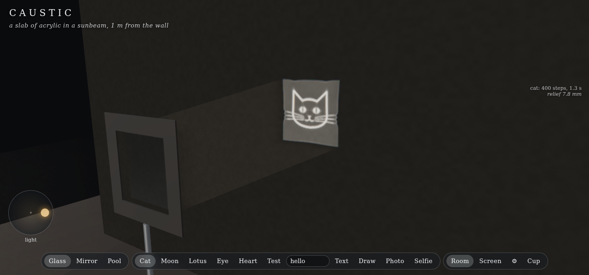
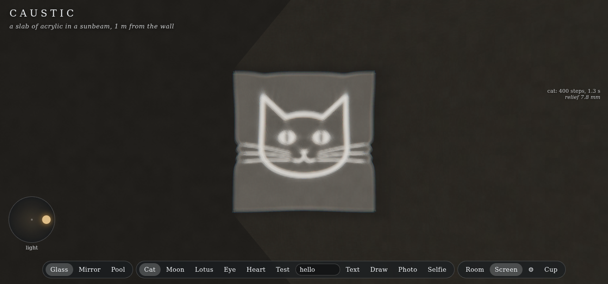
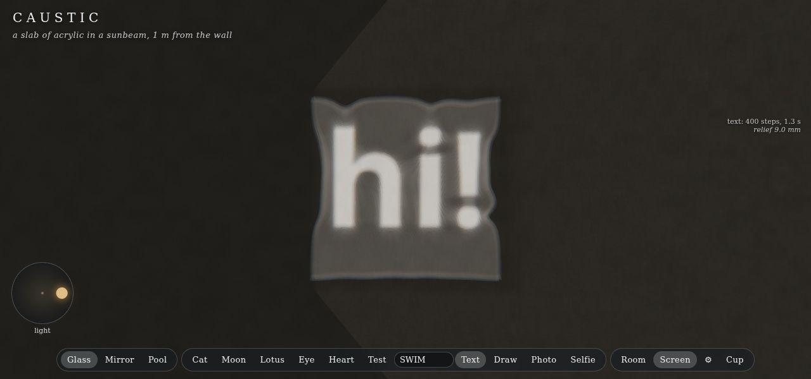
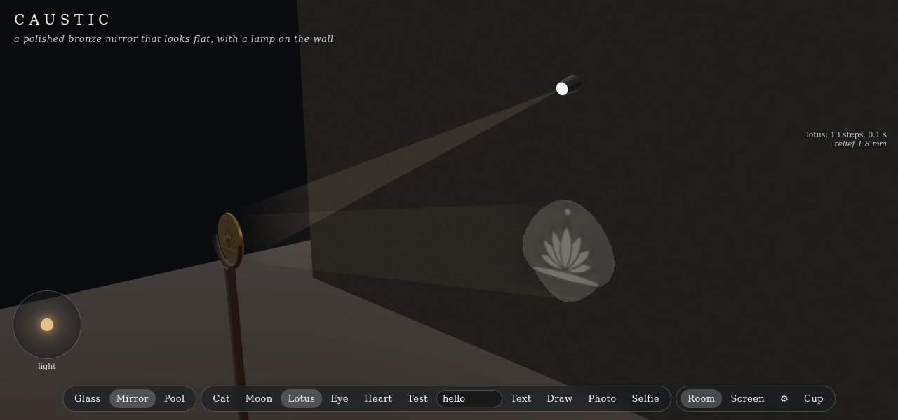
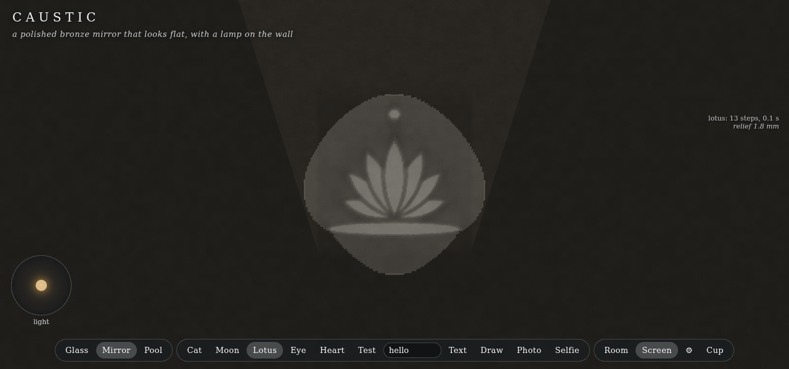
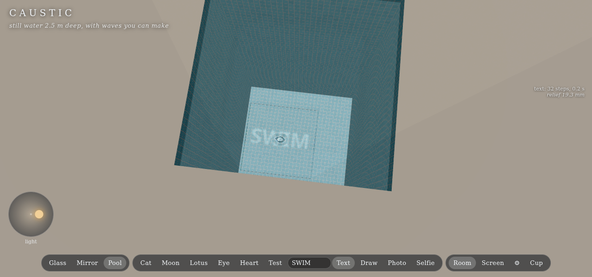
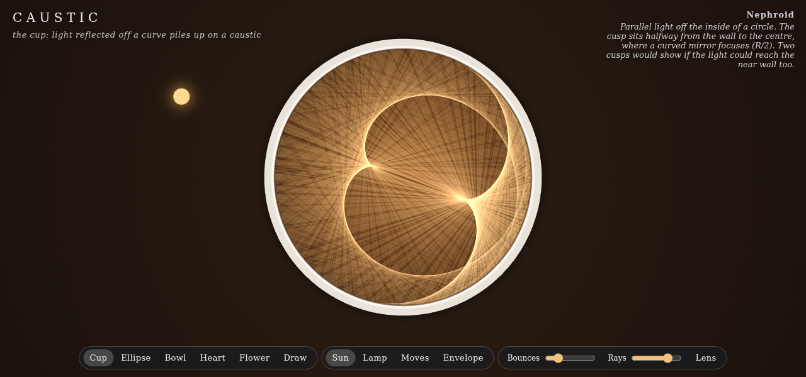
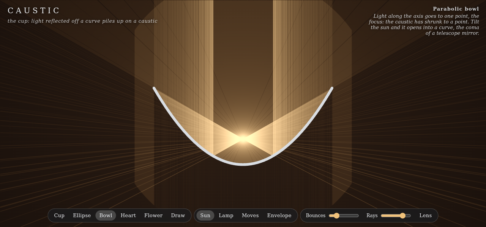

# Caustic

Codevember: Caustic. Two toys about the bright patterns light makes after a curved surface bends or reflects it.

**The lens** (`index.html`): pick a picture, type some text, draw one, or take a selfie, and the app shapes a surface so that the light it bends draws that picture. There are three surfaces:

- **Glass**: a 150 mm slab of acrylic in a sunbeam, 1 m from a wall. The relief is a few millimetres, so it looks like slightly wavy glass. Its caustic on the wall is the picture.
- **Magic mirror**: a polished bronze mirror with a lamp on the wall. Old Chinese and Japanese *makkyo* mirrors work this way: the front looks flat, but its reflection on a wall shows the picture cast on the back. Here the front relief is under 2 mm over 120 mm, and the back carries the picture in relief, as on the real ones.
- **Pool**: still water 2.5 m deep whose surface (about 2 cm of relief over a metre) writes on the floor. Tap or drag on the water to make waves: the picture breaks up into ordinary pool caustics, then comes back as the water calms. **Wind** in the settings adds random ripples.

**The cup** (`cup.html`): the bright curve inside a coffee cup, traced ray by ray. Sun or lamp, drag to move it, and pick the mirror: a cup (nephroid; a lamp on the rim gives a cardioid), an ellipse, a parabolic bowl (a point focus that opens into coma when you tilt the sun), a heart, a five-lobed flower, or one you draw. **Envelope** draws the exact caustic curve, from where each reflected ray crosses its neighbour; **Bounces** adds the second and later reflections.

## Using it

- **Glass / Mirror / Pool** (`1` `2` `3`) switch the surface. Each keeps its own design.
- Pictures: **Cat, Moon, Lotus, Eye, Heart, Test** are drawn in code; type in the box and press Enter (or **Text**); **Draw** opens a pad; **Photo** takes any image (dropping one on the page works too); **Selfie** uses the camera. The panel at the top right shows the light being moved around while the design runs: the mesh lines are the cells of light flowing into place.
- After a second picture is designed, the light **morphs** from the old one to the new one: each part of the beam slides from its old place to its new one. **Morph back** in the settings goes the other way.
- **The light pad** (bottom left): drag the dot to tilt the sun, or to move the lamp on the wall. The picture slides and distorts, since the surface was designed for one light direction. Double-click resets it.
- **Room / Screen** (`v`): the 3D room, or a view straight at the wall or floor.
- Settings (gear): **Screen distance** moves the wall or floor. The picture is sharp only at the distance it was designed for, and breaks into tangled caustics nearer or further. **Dispersion** sets how much the index of refraction varies with colour (x1 is acrylic's or water's real value), which puts colour fringes on edges. **Show relief** exaggerates the surface so you can see its shape. **Sun disc** samples the sun's real half-degree disc, which softens the picture slightly as real sunlight does. **Sun moves** sweeps the light slowly. **STL** downloads the surface in millimetres, to mill or print.
- `h` hides the interface. URL options: `n=128|256|512` (grid size: 256 on desktop, 128 on phones), `mode=glass|mirror|water`.

## How caustic design with optimal transport works

The light is conserved. A uniform beam falls on the square surface, and the picture says how much of that light should end up at each point of the screen. Shaping the surface is two problems.

**1. Where each part of the beam has to go (transport).** Split the surface into n x n cells, one for each pixel of the picture. Then move the cell corners until cell (i, j) has an area equal to the share of the picture's total brightness that pixel (i, j) holds. If every cell then sends its light to its own pixel, each pixel gets exactly its brightness. This is an optimal transport problem (move one distribution of mass onto another), solved here with the Poisson scheme of Schwartzburg et al. (2014), as Matt Ferraro describes it. Each step computes `loss = area - target` for every cell, solves `lap(phi) = loss`, and moves every corner along `-grad(phi)`. Cells that are too big shrink and cells that are too small grow. Two things keep it stable:

- The loss is divided by the square root of the cell's area (relative to a regular cell). A cell 9 times too big would otherwise get the same push as a regular one, and the steps would overshoot and oscillate.
- The step stops at half the time until any cell would fold over. A cell counts as intact while one of its two diagonals splits it into two upright triangles, so thin cells may turn concave instead of freezing the whole mesh.

A small floor of light (5%) keeps the black parts of a picture from needing cells of zero area. In the pool it is 45%, so the floor stays lit like a real pool's.

**2. Which surface sends it there (normals, then heights).** Now every point of the surface knows the screen point its light must reach. Snell's law gives the normal that bends the incoming ray toward it. In vector form the normal is parallel to `n_in * I - n_out * O` for refraction, and to `O - I` for a mirror. A height field `h(x, y)` with those normals has slopes `-N_x / N_z` and `-N_y / N_z`. These slopes don't quite form an exact gradient, so the surface is their least-squares fit, the solution of `lap(h) = div(slopes)`. Since where a ray leaves the surface depends on `h`, step 2 is repeated six times.

Every Poisson solve is exact. It uses a 2D cosine transform (Neumann edges), done with FFTs, so a 256 x 256 solve takes a few milliseconds and a whole design takes 1 to 5 seconds in a worker.

**3. Checking it.** The caustic on the screen is not drawn from the picture. It is traced from the surface. Each point of the surface's height grid is a vertex. The vertex shader refracts the ray through the flat back and the shaped front (or reflects it), and places the vertex where the ray meets the screen. The fragment shader gives each pixel the light per screen area, `|d(surface area) / d(screen area)|`, from the screen-space derivatives of the surface position. Triangles add up in a float target, so folds, cusps and caustic lines appear as they would in the real thing. There is one pass per colour channel (dispersion) and per sample of the sun's disc. On the test pictures, the traced caustic correlates 0.93 to 0.98 with the picture.

## Files

- `ot.js`: the design (FFT, DCT, Poisson, transport, heights) and a CPU forward tracer, plain JS with no DOM. `worker.js` runs it.
- `main.js`: the three.js room, the caustic pass, waves, UI, STL export. `pictures.js`: the pictures.
- `cup.js`: the cup, with a grid-accelerated 2D ray tracer and float accumulation.
- `node --test test_ot.js` (6 tests: the transforms, the solver, and a design of each surface traced back through its optics). `node smoke.js` runs headless Chromium on SwiftShader (12 checks: each surface's GPU caustic against its picture, defocus, a splash and its recovery, text, the cup) and saves screenshots to `/tmp/caustic-shots`.

three.js r187 (WebGL 2), offline PWA.
