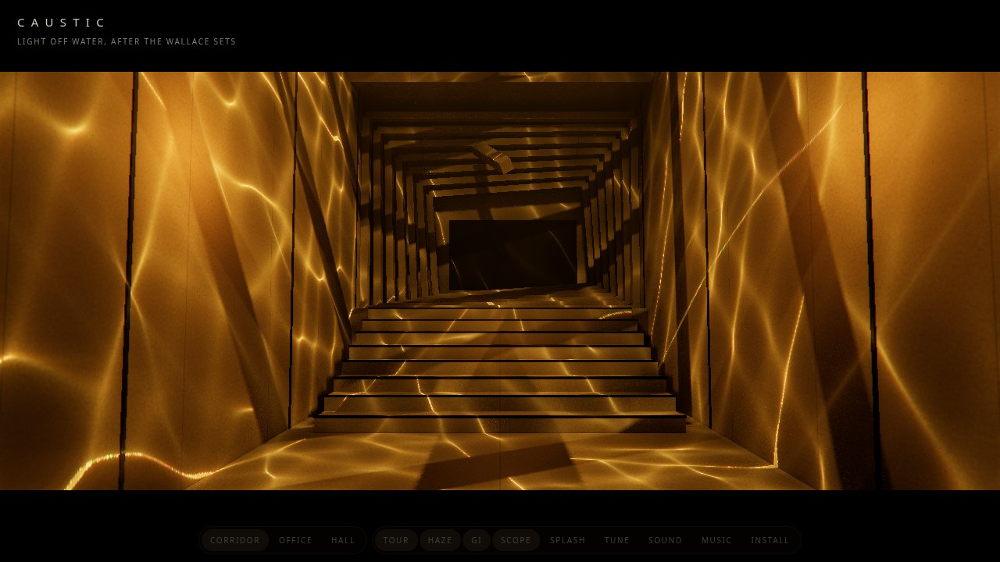
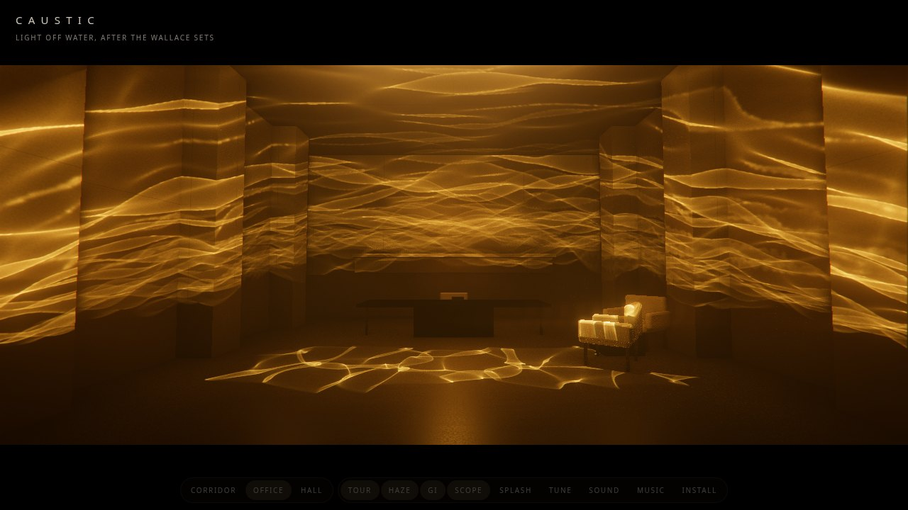
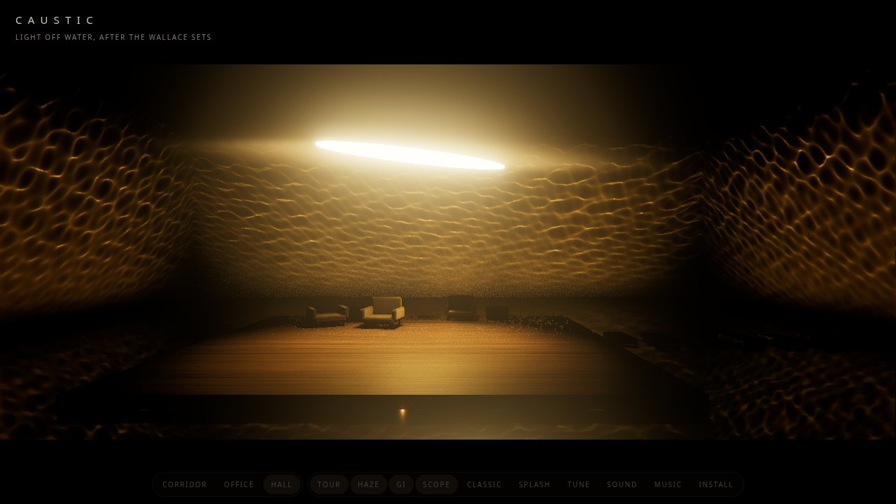

# Caustic

Light off water, after the Wallace sets in *Blade Runner 2049*. Three sets, each lit only by light thrown off rippling water:

- **Corridor**: the wide concrete passage with stairs climbing through receding, tilted portal frames, with thin bright lines running down the walls and over the steps.
- **Office**: Wallace's office: warm concrete, pilasters and a long shelf, a skylight, a desk and chairs, with broad, slow gold ribbons over the back wall and floor.
- **Hall**: the hall of water: a dark square room flooded with black water, a low wooden deck with leather chairs and a table, stepping stones off its side, a long ellipse of light swinging slowly on a cable 5 m over the deck, and ripples climbing the flat concrete walls from the waterline.

All three share one gold lamp colour, one rough concrete and one grade, so they read as one building.

## Controls

- **Corridor / Office / Hall** (keys 1, 2, 3) switch sets.
- **Tour** plays slow camera moves with fade cuts. Space jumps to the next shot. Drag to look around yourself (orbit, zoom); Tour picks the moves up again.
- **Tap a lit wall** to splash the water that lights it: a ring of ripples runs out from where you touched. **Splash** (`s`) stirs the water at random.
- **People** (`f`, or `?figures`) adds the figures from the stills: Luv in her pale dress climbing the corridor's stairs, walking in toward Wallace standing at his desk, and crossing the hall's stepping stones to him seated on the deck. They are procedural (jointed lathe and capsule parts, no model files), walk slowly back and forth with a pause and a turn at each end, their feet planted on the floor (one on each tread of the stairs, the legs reaching them by IK, the hips rising a step at a time, slower on the stairs both ways), and are lit by the same lamps, so they stand dark against the bright walls and catch the ripples where the light falls on them.
- **Classic** (`c`, or `?classic`) switches every set to the first version's light: one tiled caustic texture projected through each spot light, in place of each lamp's own water traced into the set. Two Tune sliders shape it: **Slant** lays each lamp's tile on a level plane of water near the lamp instead of square across the beam, so a beam that leaves the water low stretches the cells along its throw as the traced light does (0 is the first version's flat projection), and **Stretch** stretches them further.
- **Tune** (`t`) opens sliders: Warmth (how orange: the grade's tint and the lamps' colour), Colour (how much of the scene's own colour survives the grade), Exposure, Haze, Ripple size, Sharpness (the focus of the lines), Wave height (calm to choppy) and Water speed. Each scales the set's own value, which already holds that set's tuning (corridor: exposure 1.75, haze 6, ripples 1.63, sharpness 0.28, speed 1.35; office: exposure 0.5; hall: exposure 0.6, ripples 0.6, waves 0.5); double-click a slider, or Reset, to go back.
- `?hq` doubles the traced light's resolution (a 2048-texel short side, up to 6144 long): sharper lines on near walls, four times the texels and video memory, desktop only.
- **Haze** puts haze in the beams. **GI** turns screen-space global illumination on or off. **Scope** shows the 2.39:1 bars. **Sound** plays a drone with water under it. **Music** (`m`) plays a slow synthesised cyberpunk score. `h` hides the UI.
- Query flags: `?set=hall`, `?webgl` (the WebGL 2 backend), `?phone` (the lighter path phones get), `?nohaze`, `?novol`, `?nogi`, `?notaa`, `?steps=N` (haze steps), `?free` (no tour; the tour cuts through the three sets in turn, then round again at each set's next angle), `?paused`.

## How it works

The long version, with where the orange comes from and how the water is touched: [POST.md](POST.md).

On set, Roger Deakins lit these walls with 10K Fresnels aimed into shallow troughs of water, so the light reflected off the moving surface onto the walls (eight 10K Fresnels with custom barn doors, per his forum and the ASC write-ups). The app copies that rig rather than simulating the light transport.

- **Traced water light** (`caustics.js`, `Trough`): each lamp has its own water placed in the set, a floor trough it shines down into (reflection) or a glass tank it shines down through (refraction). A grid of rays, spread evenly in the lamp's projection, is bent by the wave normals (mirror law or Snell), pushed out to the surface each ray really lands on (a once-made map of world positions seen from the source, read twice), and drawn where it lands, each fragment adding the flat water's footprint area over the wavy water's. So the light fans out of the water's shape, stretches along the throw, is soft near the water and sharp far from it, and doesn't tile. Per set: wavelengths in metres, an rms slope, real wave speeds (slowed) and a slosh mode.
- **Spot lights at the apparent source**: each lamp's `SpotLight` sits at the lamp (tank) or at its mirror image under the water (trough), with shadows, and its `colorNode` reads the traced texture through a frustum fitted to the footprint, so the frames, beams and furniture cut real shadows into the ripples.
- **Global illumination**: SSGI (three's `ssgi` node) on an MRT scene pass, composited as `beauty * AO + albedo * GI`, then TRAA to resolve its noise. Every caustic beam also gets one unshadowed point light where it lands, a virtual point light for the first bounce off the wood or concrete, so the room fills in warm even with GI off (phones).
- **Haze**: a `VolumeNodeMaterial` box with 3D noise raymarched at half resolution with Bayer dither, lit by the same projected spots, blurred and added on top, for beams in the air.
- **Splashes**: a tap is raycast into the set, and the line from each lamp's source to the hit point is met with that lamp's water; there a ring-shaped wave packet is added to the slopes.
- **Music** (`music.js`): D minor at 84 bpm, CS-80-style detuned saw pads with slow filter swells, a sequenced resonant bass, a delayed arpeggio, a slow lead and a drum machine with a gated snare, scheduled ahead on the audio clock.
- **Water**: the hall's floor is a `reflector()` with its UVs wobbled by noise and a dark base, so the walls and the slit come back broken up.
- **Look**: ACES tone mapping, bloom, a 25-tap horizontal anamorphic streak taken from the bloom, a little edge fringe, an amber grade with a lifted toe, vignette and grain.

## Tests

`node smoke.js` runs headless Chrome over CDP (zero deps): every set and shot on WebGL 2 with everything on, then every set on WebGPU without the haze, checking the traced texture's statistics (mean about 1 over its footprint, high variance, bright peaks), each lamp's position map against CPU raycasts, that a splash changes it and a tap on a lit wall lands in a beam, that Warmth 0 drains the amber, that the score renders offline with sound, and that the console has no errors. Screenshots go to `/tmp/caustic-shots`; `SHOTS=1` refreshes the ones above. SwiftShader's software WebGPU loses its device on the haze pass (many shadowed, projected lights sampled per raymarch step), so the WebGPU run leaves it out; if a real GPU loses the device, the page reloads with `?novol`. Not yet tried on real GPUs or phones.
