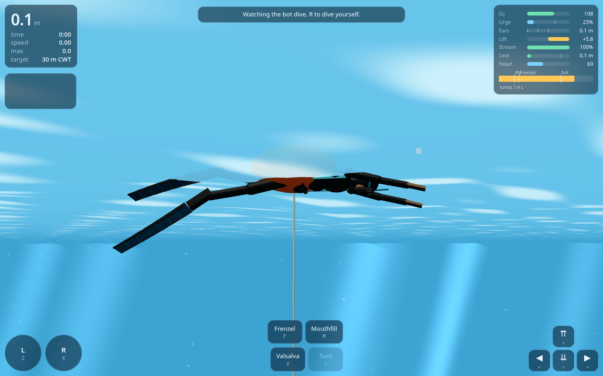
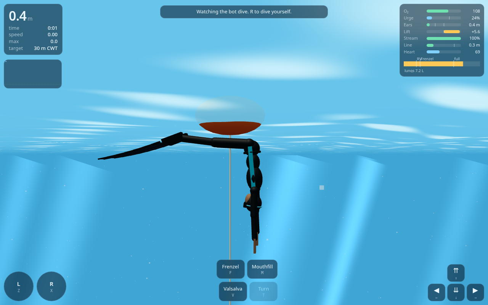
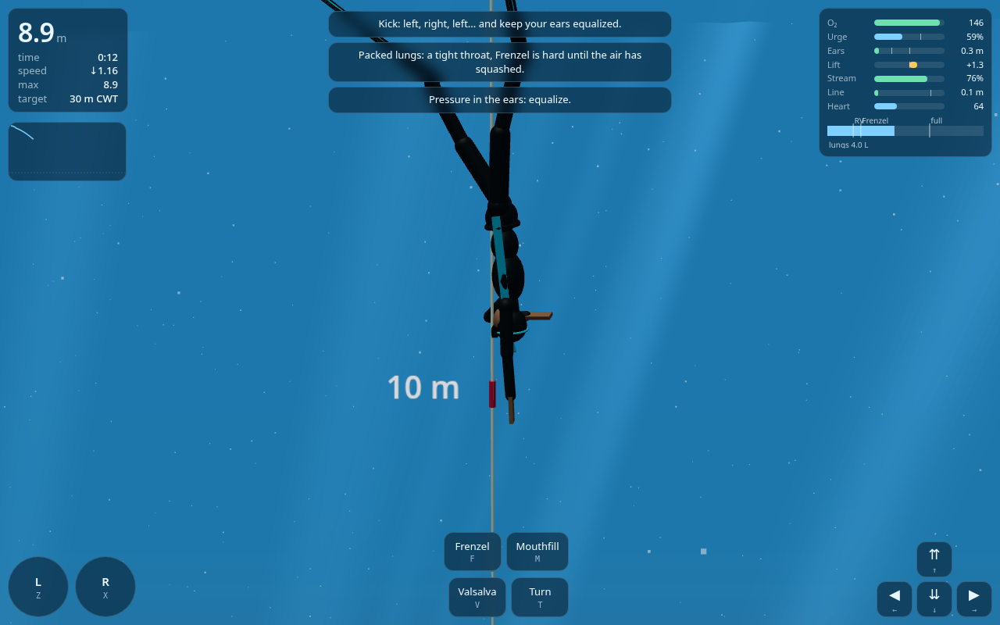
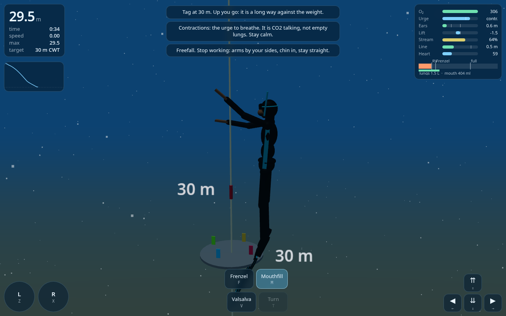
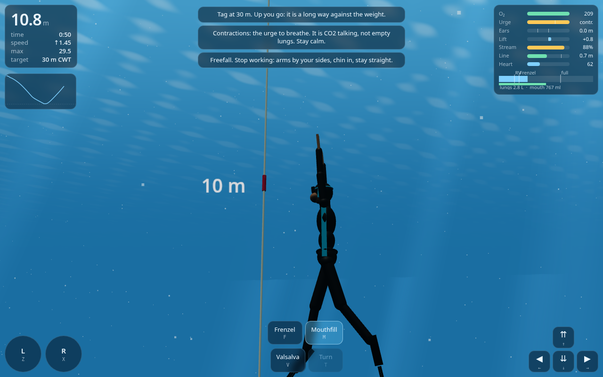

# Depth Comp

A sketch of freediving game mechanics: one breath, down a line to a plate and back up. The diver figure is a port of [one-breath](https://github.com/zz85/one-breath)'s `game/Diver.js` (jointed body, wetsuit, mask, long fins whose blades bend behind the kick), but every joint is driven by what you press instead of animating by itself. Open `index.html` from any static server (three.js comes from unpkg). `?demo` lets a bot dive.

| Duck dive: glide | Jackknife | Kicking down | The turn | Kicking up |
|---|---|---|---|---|
|  |  |  |  |  |

## The mechanics

1. **Finning.** One button for each leg (`Z` / `X`, or the L / R buttons). A flutter kick means the legs take turns on an even beat, about one kick every 0.45 s. Each kick is scored on two things: whether it alternated, and how close its gap was to the beat (a gaussian in log time, stricter on the hurried side; a first kick after a glide is fine). A good kick pushes about 26 N s along the body. A bad one pushes less, spreads the fins for more drag, twists the body, costs about twice the oxygen and bends the knee like a bicycle kick.
2. **Body position.** Buoyancy lifts at the chest (the lungs) and weight pulls at the hips, so head down is unstable and head up is stable. While you move, the fins trail like an arrow's feathers and hold the body straight, so balance matters most when you are slow: the first metres against the lift, the turn, the last metres. Your balance also drifts slowly by itself (a slow random torque, plus turbulence), so you keep correcting with `←` / `→`. They are screen-relative: an arrow moves your head that way across the screen (shifting your weight), whether you are head down or head up, so on the way down `→` swings the head right and the feet left. Divers face the line: the body twists about its long axis to keep the chest toward the rope, and swings round it at the turn. A tilted body pushes off the line and slips sideways (more drag), and drifting too far pulls the lanyard tight. `↑` puts the arms ahead (the best streamline and the steadiest head-first position), `↓` puts them by your sides (the relaxed freefall).
3. **Free immersion.** The Rope (FIM) discipline turns the same two buttons into hands pulling over each other, about one pull every 0.75 s. You pull along the rope the way your head points. Holding the rope keeps you close to it and straightens the body, so balance is easier, but each pull costs more.
4. **Equalizing.** The middle ear has to keep up with the water pressure. Pain starts at about 2.5 m behind, and an eardrum gives way past 4 m. `F` **Frenzel**: the tongue pushes air from the mouth into the ears. The lungs refill the mouth until they shrink to about 1.3x residual volume (the Frenzel limit: about 21 m on a plain full breath, deeper with packing). `M` **mouthfill**: lock a mouthful of air in your cheeks before the limit, and Frenzel from it until it is squashed below 0.2 L. That carries you about three times deeper in pressure, and it works best taken just before the limit. `V` **Valsalva**: works well head up near the surface, weak head down, useless once the lungs are small, costly, and it loses the mouthfill.
5. **Breathe-up and packing.** Hold `Space` to inhale (the breath grows the longer you hold it) and let go to exhale. Slow breathing with long exhales raises *relaxed*, which lowers how fast you burn oxygen. Fast, deep breathing washes CO2 out: the urge to breathe comes late and the blackout line moves up, so you get less warning and less margin. On a full breath, `P` packs extra air in gulps, up to +3 L, each gulp adding less than the one before. Packing gives more oxygen, a deeper Frenzel limit and a lower lung squeeze risk. It also gives more lift to fight in the first 15 m, a dizzy, wandering balance, a stiff throat for the first Frenzels, and, if you pack past about 2.6 L and linger at the surface, a packing blackout.

The rest of a dive: `Enter` duck dives: from the buoy you glide face down away from the line, fold forward at the hips so the head goes down and the face turns back to the rope, lift the legs, pull once and put a hand to the nose. `T` turns at the plate, or earlier for a yellow card. The ascent burns the most oxygen. At the surface, take hook breaths (`Space`) and give the OK sign (`O`) within 15 s. Cards follow competition rules: red for a blackout, a samba (loss of motor control), an injury, or no OK; yellow for an early turn or a late first breath.

## The model (sim.js)

Everything is in SI units, in a 2D plane (x across, y up) with the body's angle as its third axis, integrated at 240 Hz.

- **Pressure** is 1 atm plus 1 per 10 m. Gas (lungs, mouth, neoprene) shrinks as 1/P. Full lungs (6 L), a suit worth 2.5 kg of lift and 4 kg of tissue and lead make the diver neutral at 11 m. Packing 2 L moves that to 16 m.
- **Drag** is quadratic: 0.055 m² along the body (scaled by arms, fresh kicks, wobble and leaning; 1.6x going feet first) and 0.55 m² across it. Freefall settles at 0.7 to 1 m/s past 25 m.
- **Torques:** the lungs' lift at 0.34 m from the hips (0.27 m with the arms ahead), the fins' alignment (30 × v × sin of the slip angle), your lean (16 N m), turbulence and the slow balance drift (Ornstein-Uhlenbeck processes, larger when dizzy), and rotational damping.
- **Oxygen:** the lungs' O2 fraction falls with what you burn: 0.2 to 0.3 L/min at rest (lower after the dive reflex sets in, higher with tension), plus a cost for each kick, pull and equalization. The blood buffers about 6 L of it. The brain's PO2 follows the lungs' fraction × pressure with a 6 s lag. Blackout happens at 0.035 atm (higher after hyperventilating). Because of the lag, the lowest point is just after you surface.
- **CO2 / urge** builds with time and work. Past 1 it brings contractions, which add tension, which burns more oxygen.
- **Injuries:** the eardrum (the pressure behind your ears over time) and lung squeeze (lungs below 0.6x residual volume, worse when fast and tense).

## Files

| File | |
|---|---|
| `sim.js` | the dive: physics, physiology, phases, cards. No DOM |
| `bot.js` | a diver that plays it, well or with one fault on purpose |
| `diver.js` | the three.js figure, posed from the dive each frame |
| `main.js` | water, line, plate, marine snow, camera, HUD, keys and touch buttons |
| `audio.js` | heartbeat, kick swish, ear click, gulp, breath (synthesised) |
| `test_sim.js` | `node test_sim.js`: buoyancy, balance, finning, equalizing, breathe-up, whole dives (35 checks) |
| `smoke.js` | `node smoke.js`: headless Chromium (SwiftShader). It drives the buttons and the bot's dive, checks for errors, and writes `shot_*.png`. `ONLY=icons` renders the PNG icons |
| `probe.js` | `node probe.js 40 6 CWT '{"mash":true}'`: one bot dive, printed every 5 s, for tuning |

## Open questions

Ideas this sketch could test next: a monofin (dolphin kick on one button, rhythm instead of alternation), mask equalization, a narcosis wobble past 30 m, hands-free equalization, a lanyard you clip on, and a training mode that hides the oxygen bar the way real divers have to.
