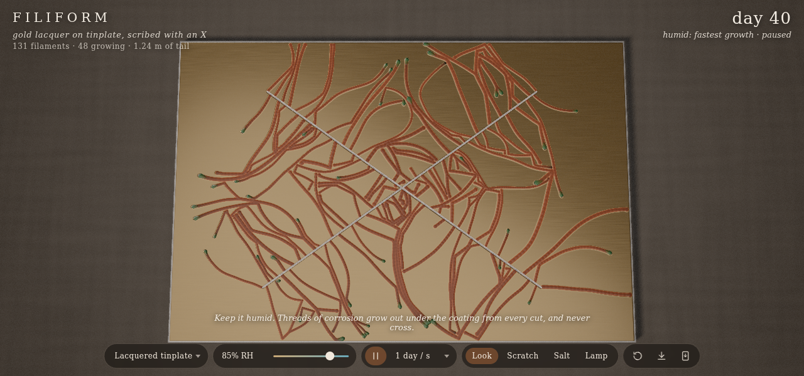
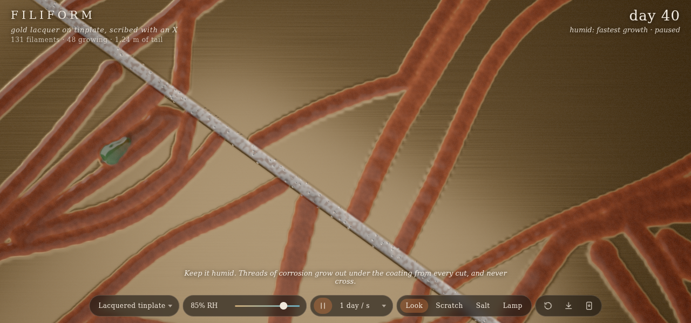
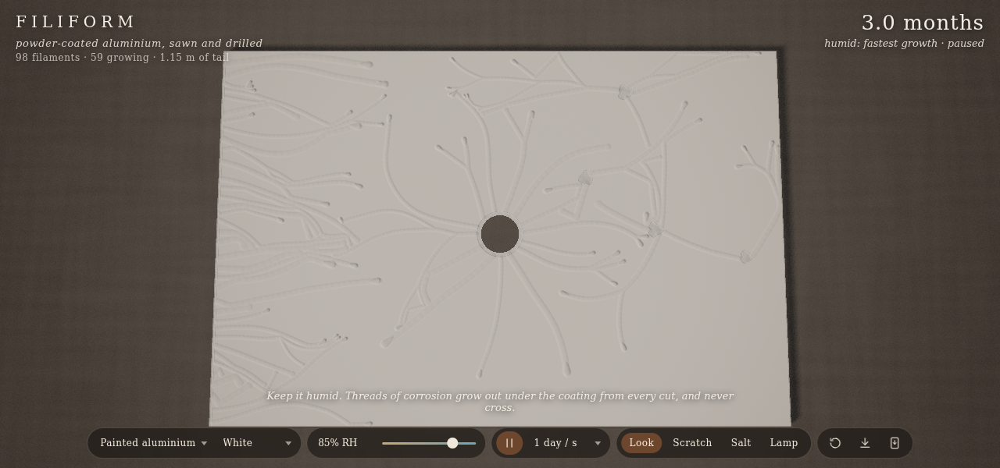
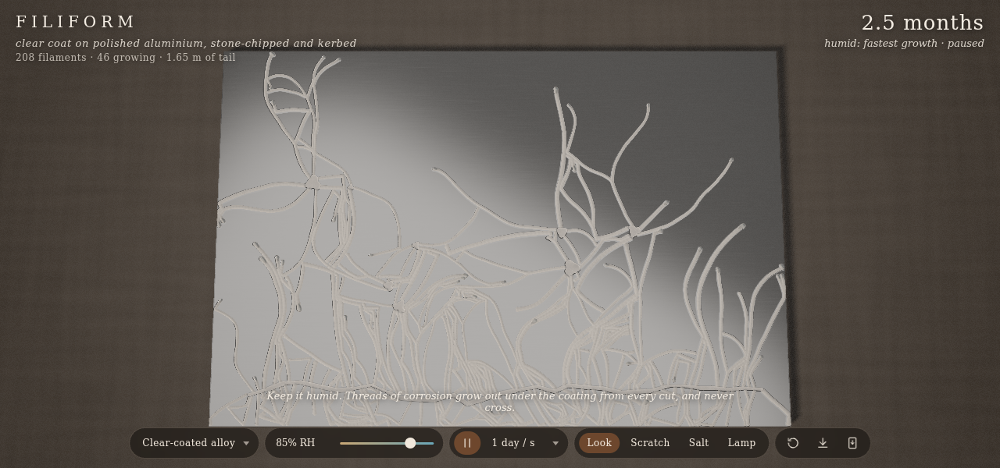

# Filiform

Codevember: Rust. Filiform corrosion is the kind that grows under a coating as threads: from a scratch or a chip in lacquer or paint, once there is salt on the metal and the air is humid, small wet heads tunnel along under the coating and leave a ridge of dry corrosion product behind them. They wander, now and then split in two, turn away from each other's tails and never cross. You see it on old biscuit tins, aluminium window frames and alloy wheels. Here it grows on a panel under a lamp on the bench while you change the humidity, scratch the coating and salt it. three.js r187 WebGPU and TSL, offline PWA.

## Using it

- **Panel** (`p`):
  - Lacquered tinplate: gold lacquer on tinned steel, scribed with an X and salted, as in the standard test. Red-brown tails, blue-green heads.
  - Painted aluminium: powder-coated, with a sawn edge, a drilled hole and a few chips. The tails show as ridges in the paint, best in raking light, and old ones crack along the crest. Pick the paint colour.
  - Clear-coated alloy: polished aluminium under a clear coat, stone-chipped, with a kerb scrape along the bottom. White tails.
- **Humidity** (slider, up and down keys): below about 60% on steel (50% on aluminium) the heads rest and dry out, and pick up again when it is humid. Growth is fastest around 82 to 86%. Above about 93% the heads swell into blisters, so each tail's width records the humidity it grew in.
- **Speed** (`[` `]`): an hour to a month a second. Pause with space.
- **Tools** (`1` to `4`):
  - Look: drag to pan, wheel or pinch to zoom, right-drag to tilt. Double-click flies in to a spot.
  - Scratch: drag to scratch through the coating, tap to chip it. A scratch carries a little salt, so new filaments start from it.
  - Salt: drag to sprinkle salt. It only matters where the coating is broken.
  - Lamp: drag to move the lamp around and up or down.
- Restart is `r`, save a PNG is `s`, `h` hides the interface.

URL options: `piece=tinplate|frame|wheel`, `paint=white|cream|anthracite|green|red`, `rh=40..98`, `speed=0..4`, `seed=`, `age=` (days to grow before showing it; 10 by default), `res=` (grid width in cells; 768, or 512 on phones), `tool=`, `paused`.

## How it works

- **Filaments** (`sim.js`, plain JS on the CPU): the panel is a grid of cells about 0.08 mm across (60 by 40 mm). Each filament is an agent with a position, a heading and a width of 0.15 to 0.6 mm.
  - It starts on the coating's side of a defect's edge, pointing away from the bare metal, at a rate set by the salt there and the humidity, where there is room.
  - Its heading wanders: the curvature is a random process along the path (Ornstein-Uhlenbeck), so it bends smoothly whatever the speed.
  - It looks ahead and to both sides for what it can't grow into: dry tail (other filaments', or its own from further back), bare metal and the panel's edge. Side feelers steer it away, so it runs along a tail. A tail ahead turns it to its mirror direction, pulled toward running alongside. One it meets head on stops it. A final check where it would land turns it further or stops it, so tails hardly ever cross (the tests check under 0.2% of moves, and usually none).
  - A head that reaches bare metal, such as a new scratch, opens to the air and dies. Now and then one splits in two (more often on aluminium), or dries out and stops, leaving a slightly wider bulb.
  - Speed follows the humidity (0.4 mm a day at best on steel, 0.2 to 0.24 on aluminium); the width relaxes toward a target set by humidity, wider when it is wetter, and much wider when it blisters.
  - As it moves, the head lays its tail as a domed ridge with faint growth bands, recording when and by which filament each cell was laid.
- **Drawing** (`main.js`, `surface.js`): the changed cells go to two textures each frame (tail, head, defect and time laid in half floats; salt, the head's front-to-back position, activity and a per-filament hue in bytes), and one `MeshPhysicalNodeMaterial` draws the panel from them:
  - under the coating, brushed or polished metal, then the corrosion product where the tail is: on steel dark when new, red-brown in a few days, darker over months, with a lighter edge, and damp and dark just behind a head; on aluminium a grey gel drying to white powder;
  - the heads: blue-green at the front fading to olive on steel, grey on aluminium, dull when they rest;
  - the coating over it: gold or clear lacquer as a clearcoat lifted over the ridges, or opaque paint whose ridges catch the light, stained a little over steel and cracked along old tails;
  - bare metal in the cuts, corroding with the humid days and the salt, and salt crystals on top;
  - heights from the same layers (sampled with a B-spline bicubic so the ridges stay smooth), turned into one normal under the coating and one on top of it by screen-space differences.
  A studio environment for the lacquer to reflect, a raking lamp with shadows, a linen bench, vignette and grain.

## Test

- `node --test test_sim.js` runs the filament model without a browser (9 tests): nothing starts on an intact or unsalted coating; filaments start from a salted scribe and grow at about the right speed; dry air stops growth and humid air restarts it; growth peaks at the right humidity and blisters above it; tails don't cross; a head that reaches a scratch dies; the same seed gives the same panel; every changed cell is reported to the renderer.
- `node smoke.js` loads each panel in headless Chromium (WebGPU on SwiftShader, `?offscreen`) and checks that it renders without errors, that filaments grow and show, that dry air stops them, that a new scratch starts new ones, that 97% swells the heads, and that the paint and alloy panels grow from their own defects (19 checks). Shots go to `/tmp/filiform-shots`, and `SHOTS=1` copies the ones above into this folder.
