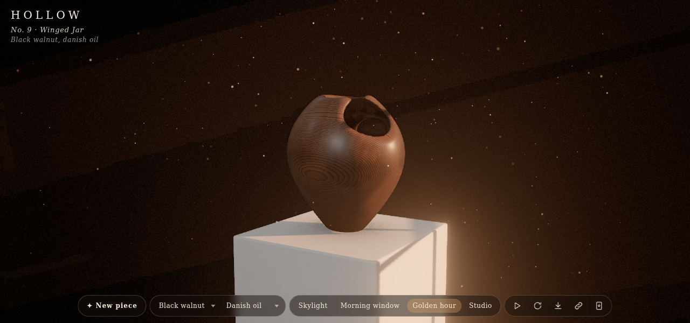
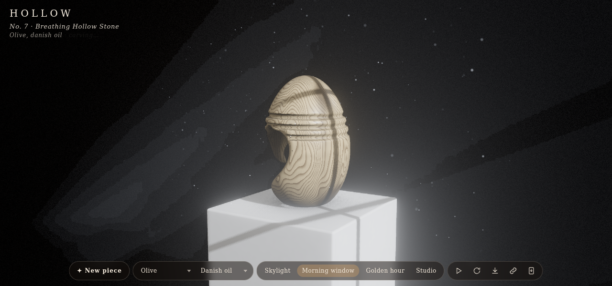

# Hollow: carving wood with distance fields

Codevember's prompt for the 8th was "hollow". I wanted a small gallery that makes a new wooden sculpture whenever you ask: a vessel or stone with tunnels and scoops cut through it, sanded, oiled and lit on a plinth. It lives in [vibes/hollow](./), and the address bar always holds a link to the piece you're looking at.

## The shape is a function

Each piece is a signed distance field. A seed picks a base form (a turned vessel, a pebble, a twisted totem, a ring or a chain of lobes) and then the cuts: round-cone tunnels, scoops, grooves and sometimes a gyroid lattice clipped to a sphere.

The cuts are subtracted with a smooth maximum instead of a hard one, and that is what makes it look carved rather than computed: every edge where a tunnel meets the surface gets a fillet, the rounding a woodworker would sand in. A shell option hollows the inside. A quick low-resolution pass rejects any cut that splits the piece, and the bottom is sliced flat so it stands.

## From field to mesh

A web worker meshes the field with surface nets, keeps only the largest solid part, and pulls each vertex onto the true surface with Newton steps. A coarse mesh shows at once and a finer one, around 100k triangles, replaces it. The worker also bakes occlusion into each vertex by tracing a small visibility grid, which is what darkens the inside of a vessel.

## Wood that goes all the way through

A texture painted onto a carved shape looks wrong, because the grain ignores the cuts. The shader here is solid instead: each surface point sits inside a virtual log, and its colour comes from its distance to the log's centre. Rings run straight through every tunnel and show as ellipses where a cut crosses them.

The material is a three.js TSL `MeshPhysicalNodeMaterial`. On top of the rings, with their drifting widths and darker latewood, it adds fibres, pores, oak's ray flecks, the shimmer of curly maple, spalting lines and darker end grain. There are nine woods and four finishes (oil, wax, lacquer, bare), each finish setting clearcoat, sheen and roughness.

## Lighting the piece

The studio is a curved backdrop, a plaster plinth and one shadowed key light, with a window or skylight frame that only the shadow camera can see. The frame shapes the pool of light, throws mullion shadows across the piece, and gives the godrays something to come through. The post chain uses three.js r187's TSL nodes: GTAO, godrays from the key light's shadow map, bloom, then vignette, grain and AgX tone mapping. It runs on WebGPU with a WebGL 2 fallback.

Dust motes drift through the room, and each one checks the key light's shadow map, so it only shows inside the beam and blinks out as it falls into the shadow of a mullion or the piece. They turn as they fall and catch the light now and then, which does more to sell the sunbeam than the haze alone.

## Watching it

Press play and it carves a new piece every two seconds in a random wood and finish. This turned out to be the best way to use it: you see the range of the generator quickly and stop on the ones you like. The hash keeps the seed, wood, finish, light and camera, so any piece you stop on can be shared exactly.
