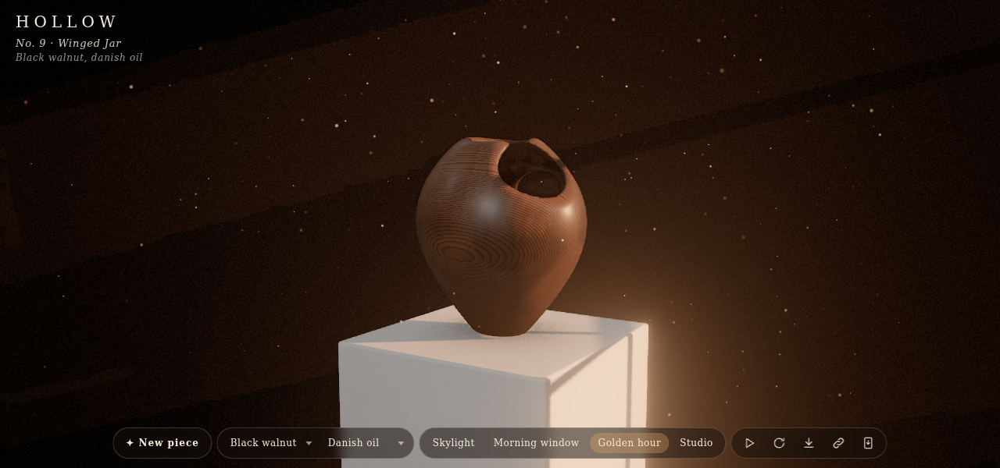
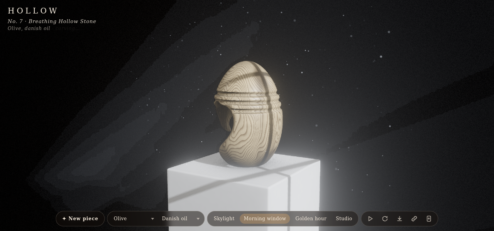
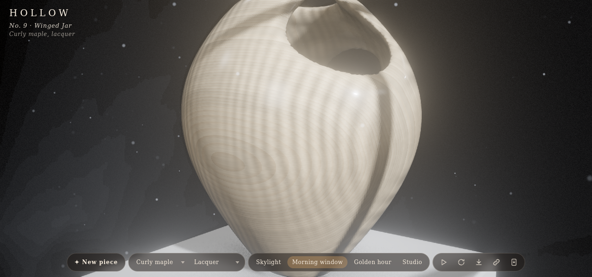
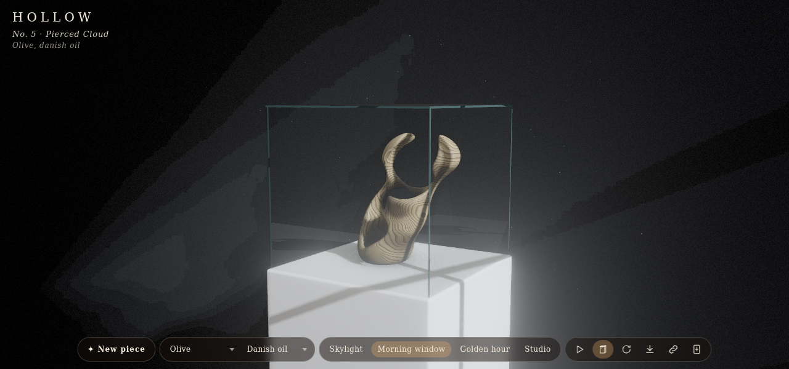

# Hollow

Codevember: Hollow. Each seed carves a wooden sculpture: a vessel, pebble, totem, ring or cluster of lobes, pierced by tunnels, scoops, grooves and lattices, often hollowed into a shell. Every cut is blended with a fillet, so the piece reads as finished woodwork rather than a boolean. It stands on a plaster plinth in a small gallery, lit by a skylight, a morning window, low golden sun or a studio setup, with shadows, light shafts through the opening, ambient occlusion and bloom. three.js r187 WebGPU (WebGL 2 fallback), TSL throughout, offline PWA.

## Using it

- **New piece** (`n`) rolls a new seed. The seed is kept in the URL, so a piece can be shared.
- **Wood** (`w`): black walnut, white oak, cherry, curly maple, olive, zebrano, padauk, ash, spalted beech.
- **Finish** (`f`): Danish oil, beeswax, lacquer, bare.
- **Light** (`l`): Skylight, Morning window, Golden hour, Studio.
- **Autoplay** (play button, `p`) carves a new piece in a random wood and finish 2 s after the last one finishes.
- **Glass** (case icon, `g`) puts the piece in a glass display case. The piece is scaled down to fit where it would touch the panes, and the dust stays outside.
- **Link** (`c`) copies a link to what you see. The address bar always holds it too, as a hash: `#seed=12&wood=olive&finish=wax&light=window&cam=1.1,1.5,1.8,0,1.2,0`, plus `still` when the turntable is off, `play` when autoplay is on and `glass` when the case is on. Wood and finish are left out unless you chose them, since the seed picks them.
- Drag to orbit, pinch or scroll to zoom. `t` or space turns the turntable, `s` saves a PNG, `h` hides the interface.

URL options, in the query or the hash: `seed=`, `wood=`, `finish=`, `light=skylight|window|golden|studio`, `cam=`, `still`, `glass`, `q=0|1|2` (quality tier; phones start at 0), `webgl` (force the WebGL 2 backend), `nodust`.

## How it works

- **Sculpture** (`sdf.js`): a signed distance field. The base form is a turned vessel profile, an ellipsoid pebble, a twisted tapered totem, a torus ring or a chain of lobes. Cuts (round-cone tunnels, scoops, torus grooves, a sphere-gyroid lattice) are subtracted with a smooth max, which leaves a fillet on every edge. A shell option hollows the inside; a closed shell gets an opening forced into it. A low-resolution check drops any cut that splits the piece, and the bottom is sliced flat so it stands.
- **Meshing** (`sdf.js`, in `mesher.worker.js`): surface nets over a grid of 104 to 152 cells, skipping empty blocks, keeping only the largest connected solid. Vertices are pulled onto the surface with Newton steps and normals come from the field gradient. Each vertex gets baked occlusion (a probe along the normal times a visibility grid traced against the piece and the plinth) and curvature. A quick coarse mesh shows first, then the fine one replaces it.
- **Wood** (`wood.js`): a TSL `MeshPhysicalNodeMaterial` with solid grain. The piece is cut from a virtual log, so growth rings follow the log axis through the carving: rings with drifting widths and latewood, warped by noise, anti-aliased with `fwidth`; fibres, streaks, ray flecks for oak, pores, curl chatoyance for maple, spalting lines, darker end grain. The finish sets clearcoat, sheen and roughness; occlusion and curvature add a little grime in hollows. Grain also drives a bump normal.
- **Studio** (`studio.js`): a cyclorama wall, plaster plinth, a shadowed key light, hemisphere fill and a rim light. The skylight or window frame is an invisible mask that only the shadow camera sees, so it shapes the pool of light and the mullion shadows.
- **Dust** (`dust.js`): instanced sprite motes that fall and drift through a box around the plinth, placed by a formula of index and time on the GPU. Each one tests its place against the key light's shadow map, so it shows only inside the beam and goes dark in the shadows of the window frame and the piece, and it glints as it turns. The motes have their own pass, added before bloom, and hide behind the piece by comparing against the main pass's depth.
- **Glass** (`glass.js`): five thin panes in their own pass, shaded in one node: Fresnel at both faces of a 6 mm slab, a reflection of the room from the environment map, with the plinth top traced as its own plane (lit and shadowed by the shadow map), a sun glint where the panes are in the beam, a sea-green tint along the cut edges where the path through the glass is long, and a little settled dust on the lid. The composite darkens and tints what is behind the panes by their coverage and adds their light, before bloom, so the glint blooms. The motes test a box around the case and go out inside it.
- **Post** (`main.js`): a render pipeline with MRT normals, GTAO, godrays from the key light's shadow map (bilateral-blurred), bloom, vignette and film grain, AgX tone mapping. Pixel ratio adapts to frame time.

## Test

`node --test test_sdf.js` checks the mesher: closed and outward-wound, shell interiors darker, 24 seeds each one piece standing on its foot, determinism. `node smoke.js` loads the app in headless Chromium (lavapipe or SwiftShader) and checks every light, wood, finish and several seeds for errors and sensible frames; shots go to `/tmp/hollow-shots`, and `SHOTS=1` copies the ones above into this folder.
