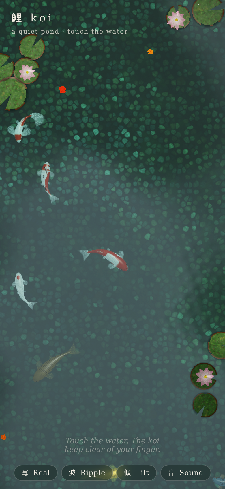
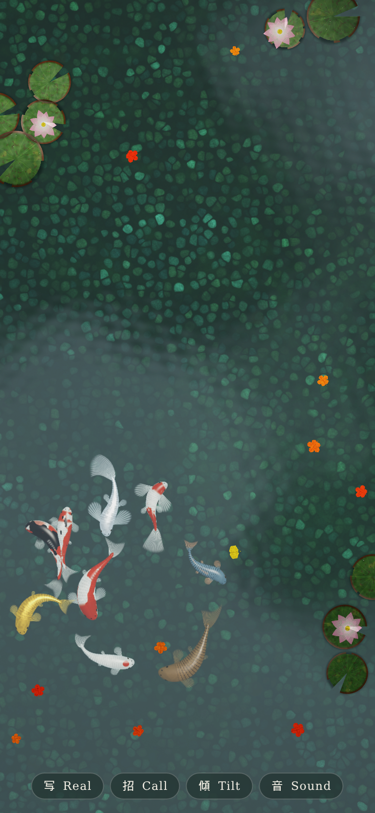
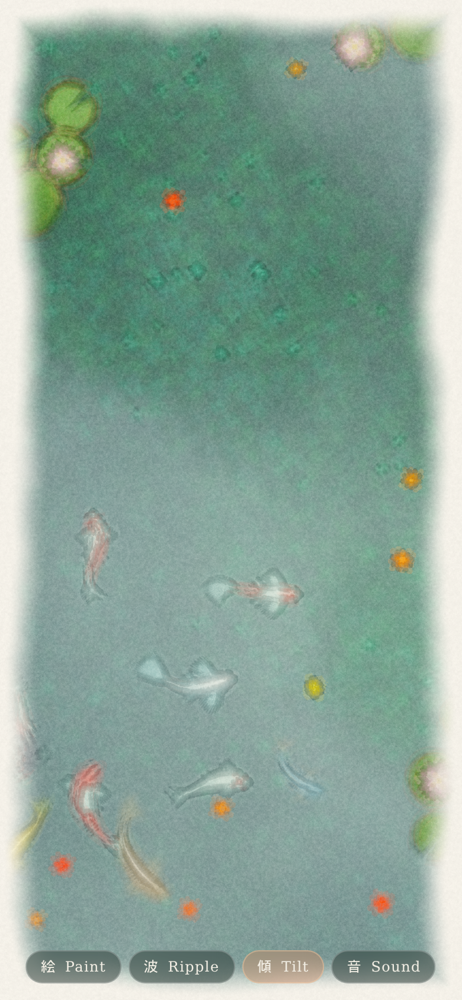

# Koi 鯉

A quiet koi pond to leave open for hours, in three.js. Seen from above: a pebble bottom under a metre of green water, sunlight coming through a maple canopy, caustics drifting over the stones, a dozen koi cruising, lily pads with water lilies, and leaves or petals floating down by season. Open `index.html` from any static server (three.js comes from unpkg via an import map). It installs as a PWA and works offline after the first visit.

| Realistic | Hold to call | Watercolour |
|---|---|---|
|  |  |  |

## Using it

The buttons fade after a few seconds; any touch brings them back.

- **写 Real / 絵 Paint**: the realistic pond or an animated watercolour of it.
- **Touch modes** (波 Ripple, 餌 Feed, 招 Call):
  - *Ripple*: a touch drops a ring of ripples and a drag draws a wake; the koi move away from your finger. Tapping a lily pad rocks it.
  - *Feed*: a tap scatters food pellets and a drag sprinkles them. Hungry koi rise, gulp them at the surface with a little ripple, then dive. Each fish gets full and loses interest for a while.
  - *Call*: hold a finger on the water and the koi gather and mill under it near the surface.
- **傾 Tilt** (phones): tilting moves the camera over the pond, so the surface slides over the deeper bottom, the sun glint moves on the ripples, and leaves, food and pads drift downhill. Moving the phone sloshes the water, and a shake scatters the fish, which dive and settle back. Tilt is measured against how you are holding the phone, which follows slowly, so any grip works. iOS asks for permission on the first tap.
- **音 Sound**: a synthesised trickle, drops now and then, a bamboo shishi-odoshi every minute or so, and a plip for each touch and mouthful.

Keys: `p` style, `m` touch mode, `s` sound, `h` hide the buttons. The screen is kept awake (Wake Lock) while the page is visible.

URL options: `?style=paint`, `?mode=feed|call`, `?fish=14`, `?season=spring|summer|autumn|winter` (default from the date: cherry petals in spring, maple and ginkgo leaves in autumn), `?seed=3` for the same pond again, `?q=0.7` to fix the render scale.

## How it works

About 1,600 lines of ES modules, no build step, no npm dependencies. Everything visible is a custom `ShaderMaterial`, and all textures and geometry are generated at start-up. Units are metres: the view is 3 m across on its short side, the pond 1.1 m deep, the koi 0.45 to 0.8 m long.

| File | |
|---|---|
| `main.js` | render passes, camera, touch and motion input, UI, adaptive quality, test hooks |
| `glsl.js` | shared uniforms and GLSL: noise, water optics, canopy light, caustics, ripples |
| `pond.js` | caustic texture, pebble bottom, the composite pass through the surface, the realistic grade |
| `koi.js` | koi body and fin geometry, their shaders, colour varieties, swimming behaviour |
| `surface.js` | lily pads, water lilies, floating leaves / petals / food, their drift |
| `paint.js` | the watercolour pass |
| `audio.js` | synthesised sound |
| `smoke.js` | headless check (`node smoke.js`) |

### Frame

1. **Shadow map**: fish, pads and leaves are projected along the sun onto the bottom and drawn, from directly above, into a 512 px map.
2. **Fish**: the koi are drawn without refraction into `fishRT` (4x MSAA).
3. **Composite**: one full-screen pass per pixel traces the view ray to the surface, takes the surface slope from the ripples, a slow swell, wind "cat's paws" and the slosh, refracts the ray (n = 1.333) down to the bottom and reads the pebble texture there. It lights that point with the sun through the water column and the canopy, the caustics and the blurred shadow map, then applies the water's absorption and scattering along the bent path. The fish are read through the same bent ray, so they wobble under the ripples. On top: the Fresnel reflection of sky and canopy, and sun glints. The pads, lilies and floaters are drawn over it into `sceneRT`.
4. **Finish**: ACES tone map and vignette, or the watercolour pass.

Colour is linear throughout and stored as `sqrt` in 8-bit targets so the dark water does not band (no float render targets are needed, which keeps older phones working).

### Water

- **Optics**: Beer-Lambert extinction per channel (`uSigma`, red absorbed first) on the sun's way down and the view's way back up, plus in-scattered light. That one model shades the bottom, the fish at their depth and the fins, so a koi visibly fades into green as it dives.
- **Caustics**: a tileable texture made once on the CPU by sending about 600,000 photons through a periodic wavy surface onto a periodic floor (about 60 ms). Two copies scroll in different directions and their minimum is the moving net; the local surface slope shifts them too.
- **Ripples**: up to 24 analytic ring packets (position, start time, amplitude) that spread at 0.32 m/s, widen, lengthen and fade. They come from touches, fish basking or feeding at the surface, landing leaves, food and shakes. Floating things are pushed by the passing fronts.
- **Canopy**: a slow, swaying noise field shades the sunlight on the bottom, the fish and the pads, and a darker leafy pattern shows in the surface reflection.

### Koi

- **Body**: a lofted mesh with a koi's top-down profile (rounded nose, widest at a quarter of the length, narrow peduncle) and a deeper belly than back. Each vertex stores its place along the body and its offset and normal in the body's own frame. The vertex shader rebuilds it each frame along a 16-point spine: a Catmull-Rom curve through points the CPU moves, plus a travelling wave whose amplitude grows towards the tail.
- **Spine**: the head steers, and every later point is pulled along the path behind the one before, with a limit on how sharply it can bend and a slow relaxation back to straight. Turns therefore bend the whole body naturally.
- **Fins**: pectoral and pelvic fans that tuck in for a glide, open and paddle when the fish hovers or brakes, and open on the inside of a turn; a dorsal fin whose top lags the body; and a forked tail whose trailing edge lags and flutters. Butterfly koi have fins about 1.85 times longer, with the tail flowing slowly. Fins are translucent, with rays and soft edges.
- **Skin**: the colour pattern is 3D noise in the fish's rest space, so it stays on the body, and it is mostly on the back. Overlapping scale rows have a fine rim (strong on net-scaled varieties), and the head has none. The fish also have eyes and nostrils, wet sheen, mirror-like scales on metallic varieties, a milky rim on white skin, and caustics on their backs near the surface. The varieties are kohaku, taisho sanke, showa, yamabuki ogon, platinum, chagoi, asagi, tancho, kujaku, kigoi, shiro utsuri and benigoi, at different lengths, three of them butterfly koi.
- **Behaviour**: each fish has its own slow, non-repeating noise for wandering, speed and depth, and now and then rises to bask. It looks ahead to turn back from the edges, keeps clear of fish at a similar depth and lines up a little with those nearby, so loose processions form. It swims by **beat and glide**: it thrusts up to speed, then coasts with the tail nearly still. Tail-beat frequency follows speed, and amplitude follows thrust. Cruising speed is about 0.3 body lengths per second.

### Watercolour

The frame is blurred into flat washes. The deep water is lifted to a mid tone and saturated, then converted to pigment density and laid over cold-pressed paper with `paper * exp(-density)`. Pigment pools at the edges between washes, settles in the paper's tooth, flocculates in darker washes and blooms unevenly. A ragged border of paper is left bare. The outlines "boil" at 8 frames a second while the paper stays still, like a hand-painted animation, and the koi go on swimming through it.

### Performance on phones

The render scale adapts: every 2.5 s, if frames average more than 24 ms the scale drops by 15% (down to 0.45), and below 17.5 ms it grows back. Device pixel ratio is capped at 2, the watercolour renders at 0.72 of that because it blurs anyway, and the bottom and caustics are textures made once. The per-frame CPU work is about a dozen 16-point spines. Default 9 fish on phones and 11 on desktop.

## Test

`node smoke.js` (headless Chromium with SwiftShader, phone-sized, zero deps) checks: no console or shader errors; every fish swims, stays in the pond at a calm speed and keeps its spine whole; touches ripple; scattered food is eaten; holding a finger gathers the fish; tilt is followed; the watercolour frame is painted. It writes `shot_*.png`. `ONLY=shots` takes the screenshots alone.
