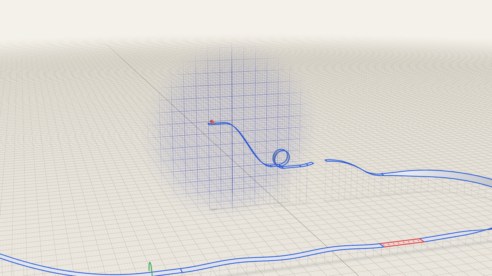
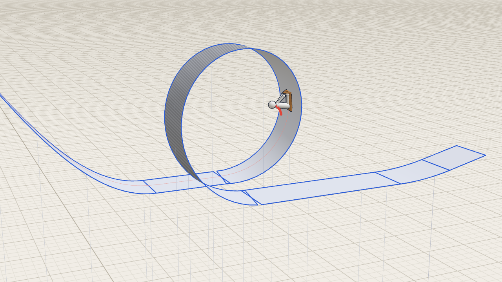

# Line Rider 3D

Line Rider taken into three dimensions. You draw a track, press Space, and a sledder rides it under gravity. Each stroke is drawn on a **sketch plane** and turned into a ribbon. Open `index.html` from any static server. three.js loads from unpkg through an import map, so there is no build step.

## Views

- **2.5D** (default, **G** toggles): a narrow-angle camera looks at the sketch plane from the side, a little above it and turned slightly back along the track. It reads like 2D Line Rider, but ribbons show their width, loops show their corkscrew and the floor below gives height. Right-drag pans, wheel zooms, nothing orbits. Turning the plane (A/D) turns the view with it, so you always draw left to right. While riding, the camera follows the rider and swings around corners to keep the motion running across the screen, never flipping sides.
- **3D**: free orbit camera (right-drag orbits), with follow / chase / free cameras while riding.

## Drawing in 3D with a 2D pointer

- **Wall plane** (default): a vertical plane you look at from the side. Inside one plane it behaves like 2D Line Rider: draw left → right for a floor and right → left for a ceiling. **Shift** flips the riding side. The pale face is the side the rider stands on. The dark, hatched face lets the rider pass through.
- **Turn the plane** with **A**/**D** (15° per tap). Hold A/D *while* drawing and the plane turns around the pen, so the stroke curves through 3D. Shift+wheel or PgUp/PgDn moves the plane closer or further away. **V** turns the plane to face the camera.
- **Floor plane** (**Tab**): draw from above. The stroke runs downhill at the chosen grade.
- **Snapping**: start a stroke on a line end and it continues from that end, with the plane moved there and turned to match. Drag the **line tool** from one line end to another and it joins them anywhere in space.
- **Bank** (on by default): parts of a stroke that face upward tilt into turns. The tilt angle is `atan(v²κ/g)`, where `v` is the speed the rider should have at that height, estimated from the drop from the start flag.
- Line types: normal (blue), accelerate (red, chevrons point the way it pushes), scenery (green, no collision). The eraser cuts strokes where you drag over them. The 🚩 tool places the start on a ribbon, aligned with its surface.

## Physics (`sim.js`)

This is Line Rider's model with a third coordinate added:

- 11 Verlet point masses: a sled with 4 corners and a rope point, and a rider with butt, shoulder, hands and feet.
- Rigid sticks hold the sled together. Body sticks give the rider his shape. **Bindings** tie the rider to the sled, and they break when a single 1/240 s substep stretches them more than 13%. On flat ground that happens with a drop of about 4 units (the rider is about 1 unit tall). Turning upside down relative to the sled also counts as a crash.
- Collision is one-sided against ribbon segments. A point that has sunk up to 0.45 below the riding side, and is moving into it, gets pushed back out. Segments reach 0.12 past their ends so joints don't leak.
- Two additions that 3D needs:
  - **Runner grip**: when a sled corner touches a ribbon, 85% of its sideways slip per substep is redirected along the track at the same speed. Without this, a corkscrew loop slides out from under the sled.
  - **Yaw alignment**: the sled turns toward its direction of travel while it touches the track.
- Body points drag when they scrape the track. The sled doesn't. Gravity is 16 units/s². The sim runs at 60 fps with 4 substeps per frame and 3 solver iterations per substep. Runs are deterministic, and every frame is recorded, so the timeline scrubs both ways.

## Files

| File | |
|---|---|
| `track.js` | strokes → per-vertex frames (tangent, ribbon side, normal, banking) → segments in a spatial hash; save/load |
| `sim.js` | rider points, sticks, collision, grip, crash detection |
| `demo.js` | the demo track: cosine drop, corkscrew loop, lip and ballistic landing, banked 180° turn drawn top-down, accelerate strip, swells, run-out |
| `main.js` | rendering (ribbons, ink edges via `LineSegments2`, projected shadows, height posts, outlined rider, scarf, trail), sketch plane input, timeline, cameras (follow / chase / free), undo, local storage, JSON import/export |

## Test

- `bun test`: flat coasting, crash threshold, one-sided lines, the riding side follows drawing direction, accelerate lines, banked versus flat turns, the demo ridden end to end without a crash (through the loop, the turn and out to the finish), determinism, save/load.
- `node smoke.js` (`CHROME=` to pick a binary, otherwise the newest Playwright Chromium in `~/.cache/ms-playwright`): headless Chromium with SwiftShader over CDP and no npm dependencies (the same harness as Sorairo). It renders `shot_*.png` of the demo and rides it in the page. It then draws strokes with synthetic mouse and key events on an empty track and checks the results: the rider lands on the drawn stroke, a line-tool stroke snaps to the stroke's end, the eraser splits a stroke, and holding D while drawing turns the plane. It also checks that clicking a menu leaves it focused (it used to blur itself, which closed the dropdown). Any console error fails the run.

URL parameters: `demo` (ignore the saved track), `empty`, `noui`, `v3d` (start in 3D, not remembered), `still` + `t` (render one frame at that time) with `view=follow|chase|plane`.
