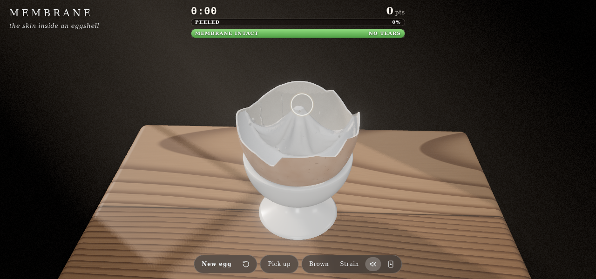

# Membrane: peeling an egg on the GPU

Codevember's prompt was "membrane". Crack a raw egg and a thin white skin stays stuck inside the shell. You can pick at its edge and peel it out in one piece if you go slowly and pull back off the wall. If you rush, it tears. This sketch makes that into a small game: peel the membrane out of a broken half shell, and lose if you tear more than 5 cm of it. It lives in [vibes/membrane](./).

## A cloth in compute shaders

The membrane is a mesh of about 5,600 vertices with 0.8 mm edges, an icosphere warped onto the inside of the shell. Each triangle edge is a link, and each pair of triangles adds a bend link across their shared edge. It is simulated with position-based dynamics, written in three.js r187 TSL and run as WebGPU compute: 8 to 10 substeps of a 60 Hz frame, with 3 or 4 Jacobi iterations each.

In Jacobi form, each vertex reads its own links (up to 12) and moves toward the average of where they want it. Every vertex runs in parallel, and the graph needs no colouring. Links are stiff when stretched and soft when compressed, so the sheet wrinkles where it bunches up instead of shrinking.

The WebGPU limit that shaped the code most is 8 storage buffers per compute stage. The main solve kernel uses all eight. Any new state goes into its own pass or into a spare channel of an existing buffer. For example, "this vertex just peeled" is a value of 0.25 in the anchor's fourth component.

## Glue and the peel angle

Each vertex starts glued to its place on the shell. It lets go when the pull from its neighbours that have already come off passes its glue strength. That pull is weighted by the peel angle, after Kendall's peel law: load x (1 - cos theta), where theta is the angle between the peeled arm and the wall ahead of the peel front. Pulling straight off the wall, or folding the sheet back over itself, peels it. Dragging along the wall barely peels it, so you only stretch the sheet until it tears. That is how it feels with a real egg.

The plain law made the sheet unzip under its own weight, especially with the shell upside down. A real membrane weighs almost nothing and clings to the wet shell. So a separate pass spreads a "reach" value out from the pinched vertex through the loose sheet, losing 0.4% per link. Pull counts in full only where that reach meets the peel front. Elsewhere, including the sheet's weight and the tension left over after you let go, it counts at 8%.

## Tearing softly

Past 15% strain a link creeps longer for good, so the membrane stays baggy where you stretched it. Each link breaks at its own strain, 0.5 ± 25%, tested against its strain low-passed over a few substeps so that one solver spike can't snap it. A breaking link necks: it fades out over a few substeps instead of vanishing. The load moves to its neighbours, so a tear runs, but the two sides drift apart and don't spring back.

## The studio

The egg sits on a small oak board on a plaster plinth, in the same kind of room as [Hollow](../hollow/POST.md): a seamless grey cyclorama lit only through a window. The window is a set of boxes in the sun's path that only the shadow camera sees. The sun falls on the board as a pool with soft mullion shadows across it, and the room around stays dark. Godrays march the same shadow map, so the haze in the beam has the window's shape. Bloom, AgX tone mapping, a vignette and grain finish it.

## Making it wet

The egg is raw, so everything is slimy:

- XSPH viscosity eases each vertex's velocity toward its neighbours' mean, so the loose sheet moves as one floppy piece.
- The bare shell gets a glossy film that breaks into beads and dries over about 9 seconds.
- About 1 in 80 vertices that peel draws a thread of egg white back to the shell. The thread keeps its volume, so it thins as it stretches and snaps once it gets too thin.

The sound is synthesised from the same ingredients. A bubble is a sine whose pitch rises as it decays. A peel crackle is a few milliseconds of band-passed noise. A squelch is noise through two resonances that glide from "oo" to "ah". All of it is kept quiet, on its own bus with a lowpass filter.

## Holding the shell

I wanted to be able to turn the shell and peel downward, as you would with a real one. The sim runs in the shell's own frame. Each step, gravity, the table and the fingertip are turned into that frame, and the cup only counts while the shell sits in it. On a phone, one finger holds the shell and another peels. On a desktop, the arrow keys or WASD tilt it while you drag.

## Testing a GPU sketch headless

`smoke.js` drives Chrome over the DevTools protocol, with SwiftShader standing in for a GPU. Headless WebGPU lost its device on the first frame it presented, so the test renders offscreen and copies each frame to a 2D canvas. A test API on `window.__membrane` grabs vertices, steps the sim and reads the counters back. With it, the smoke test checks the physics itself:

- a slow pull off the wall peels with little tearing
- a yank tears
- a shell turned upside down keeps its membrane
- the round ends in a win or a loss

It also saves the audio as WAV files to check their levels.
