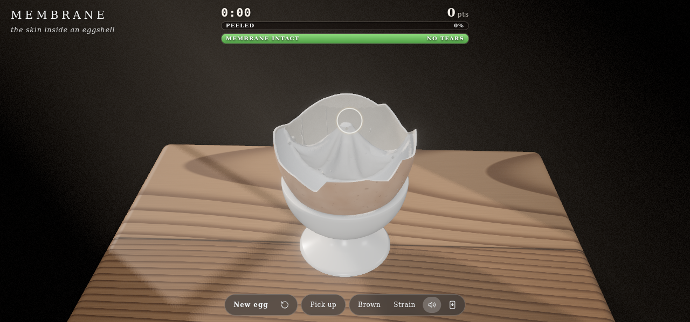
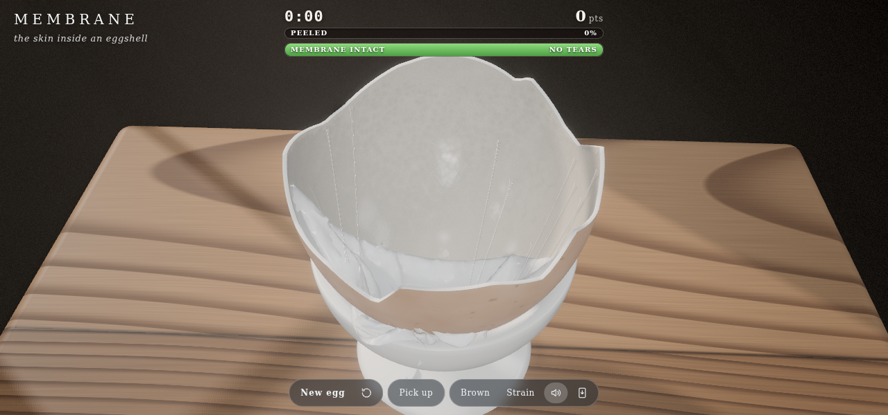
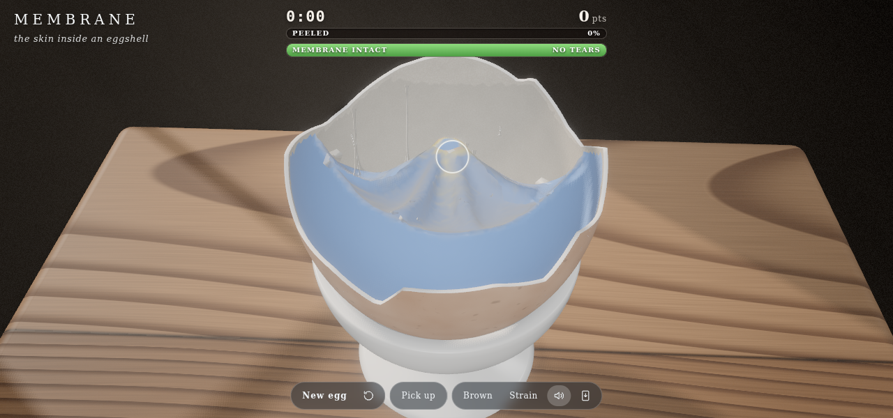
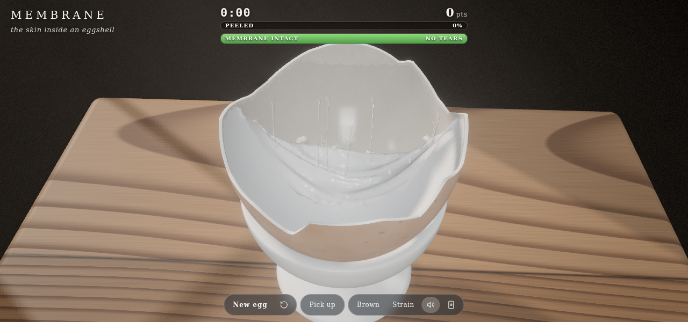
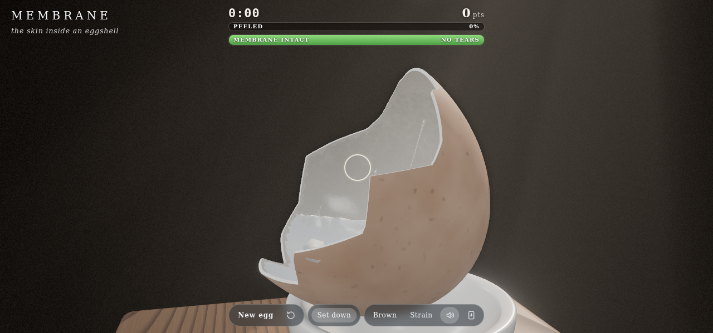
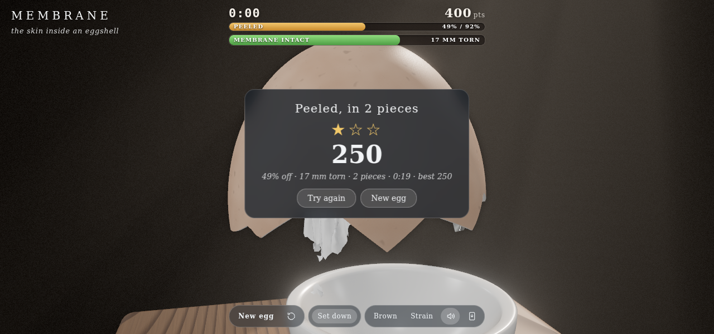
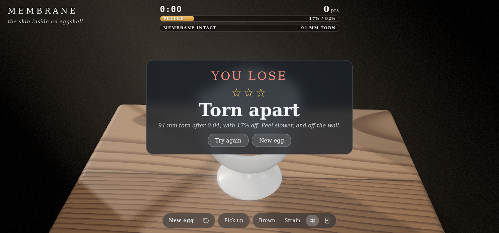

# Membrane

Codevember: Membrane. A broken half eggshell stands in an egg cup, lined with the thin white membrane that sticks to the inside of the shell. A tongue of it hangs loose at the tallest shard. Pinch it and pull: pull back off the wall, slowly, and the membrane lets go of the shell and comes away in a sheet with the bare chalky shell showing behind it. Yank it, or drag it along the wall instead of off it, and it stretches, goes thin and tears. The membrane is a GPU cloth in three.js TSL compute shaders. three.js r187 WebGPU, offline PWA.

A short write-up of how it works: [POST.md](POST.md).

## Using it

- **The game**: get the membrane off without tearing it. The bar at the top shows the time from your first pinch, your score, how much is off (it fills to a dashed line at 92%, which ends the round) and how much is left intact, a bar that drains with every millimetre torn, goes amber, then throbs red. Tear 50 mm and the membrane is ruined: **you lose**. Peeling earns up to 1000 points, every millimetre torn costs 8 (shown at your fingertip, and the bar shakes), and each extra piece the sheet ends in costs 150. A clean peel, one piece with no tears, gets three stars; one piece with under 25 mm torn gets two. Your best score is kept. **Try again** relines the same egg.
- **Drag on the membrane** to pinch it and pull. **Drag on the shell** to pick it up out of the cup and turn it, as you'd hold a real one; it stays up where you leave it. On a touch screen, hold and turn the shell with one finger while you peel with another. With a mouse, turn it first, or tilt it while you peel with the arrow keys or W A S D (Q and E roll it); right-drag anywhere also turns it. **Pick up** (`c` or space) lifts it with its opening turned toward you, so you peel the far wall down toward you; **Set down**, or a double-click on the shell, puts it back. Drag anywhere else to orbit; pinch or scroll to zoom. While pulling, the scroll wheel moves your fingertip toward or away from you. The ring at the fingertip reddens as the sheet next to it nears its breaking strain.
- **New egg** (`n`) cracks a different shell: another rim, another flap. **Start again** (`r`) relines the same one.
- **Brown / White** (`b`) changes the shell. **Strain** (`s`) colours the membrane by how stretched it is: blue at rest, yellow stretched, red about to give.
- **Sound** (`m`): crackles as the membrane peels, sharper ticks as it tears. `h` hides the interface.

URL options, in the query or the hash: `seed=`, `shell=white`, `strain`, `level=4|5|6` (mesh resolution: 5, the default, is about 5,600 vertices with 0.8 mm edges; 6 is about 22,600, and tears a little more easily, since its pinch edge is sharper), `substeps=`, `iters=`.

Needs WebGPU: Chrome, Edge, Safari 26 or Firefox 141 and later.

## How it works

- **Shell** (`egg.js`, `scene.js`): an egg-shaped surface, a little longer at the pointed end, cut by a crack made of straight runs between random knots, with one tall broad shard kept opposite the camera. The shell has an inner face, an outer face 0.55 mm out and a broken edge between them. The outside is mottled brown or white with specks; the inside is chalky with fine bumps, and is what shows once the membrane is gone.
- **Membrane mesh** (`egg.js`): a subdivided icosphere warped onto the inside of the shell, 0.12 mm in from it, jittered so tears don't run along straight lines, cut off just under the rim. Each triangle edge is a struct link, and each pair of triangles adds a bend link across their shared edge. Vertices next to the tall shard start unglued: that is the loose flap.
- **Solver** (`sim.js`): position-based dynamics in TSL compute shaders, 8 to 10 substeps of a 60 Hz step with 3 or 4 Jacobi iterations each. Each vertex gathers its own links (up to 12) and moves toward where they want it, so no colouring of the graph is needed. Links are stiff in tension and soft in compression, so the sheet wrinkles rather than shrinks. Bend links keep it from folding like paper and slowly take the shape they are held in, so creases stay. The shell, the egg cup and the table push the membrane out of them.
- **Glue and peeling**: a glued vertex is pulled back to its place on the shell. It lets go when the tension in its links to sheet that has already come off passes its glue strength, weighted by the peel angle after Kendall's peel law (load x (1 - cos theta), theta between the peeled arm and the wall ahead of the front): pulling straight off the wall peels, folding the sheet back over itself peels easiest, and dragging it along the wall away from the glued part (lap shear) doesn't peel, so the tension grows until it tears, as with tape. The law is softened (1 + 0.6 cos rather than 1 + cos), only arms lifted off the wall count, and tension under 3% strain doesn't. The load counts in full only where your pinch reaches the peel front through loose sheet (a reach that spreads from the fingertip, losing 0.4% a link); elsewhere only 8% of it counts. A real membrane weighs next to nothing and clings wet, so its own weight, or the shell turned upside down, hardly peels it: the loose part hangs and the rest stays on. The glue is patchy and weaker near the crack.
- **Holding the shell**: the sim runs in the shell's own frame. Each step gravity and the table are turned into that frame, the fingertip is held in the world and turned into it too, and the cup counts only while the shell sits in it. As the shell moves, loose sheet lags 4% of the move (a wet membrane this light goes with the air and the egg white around it).
- **Stretching and tearing**: past 15% strain a link creeps longer for good, so the membrane stays baggy where you pulled it. Each link has its own breaking strain, 0.5 ± 25%, tested against its strain low-passed over a few substeps so one solver spike doesn't snap it. A broken link takes its triangles and bend links with it, which raises the load on its neighbours, and so a tear runs. A tear parts softly rather than snapping back like a rubber band: a link near its breaking strain necks (its plastic flow speeds up, so it stores little stretch when it goes), a broken link's pull fades out over a few substeps, and the vertices at a fresh break are damped for a moment. A fast pull tears sooner without any rate term: the sheet far from the fingertip can't follow in time, so the strain piles up next to it.
- **Drawing**: the membrane mesh reads positions, normals and a per-triangle alive flag straight from the solver's storage buffers. Its colour is a fibrous noise fixed in rest space, so it moves with the sheet. A stretched sheet goes thinner, glassier and more translucent, and light from behind shows through a loose flap. Counters (links torn, vertices peeled, largest strain) are atomics read back every frame for the bar, the fingertip ring and the sound; positions are read back every few frames to pick what you touch.
- **Wet** (the glorp): the egg is raw, so the membrane is wet. Each vertex's velocity is eased toward its neighbours' mean (XSPH viscosity), so the loose sheet moves as one floppy, gloopy piece. It has a clear coat that glistens where the sheet has just come off and dulls as it dries. The bare shell it leaves is wet: a glossy, darker film drawn on the shell that breaks into beads and dries over about 9 s. A patch laid back on shell that is still wet sticks again, weakly; dry shell won't take it.
- **Threads of egg white**: about 1 in 80 vertices that peel draws a thread from its spot on the shell to itself. The thread's own length follows the distance it spans viscously, so a fast pull pulls it taut and it tugs the sheet back; its volume is kept, so it thins as it lengthens, and it snaps once thinner than 0.035 mm (between 1.5 and 6 cm, by its volume). When it is slack it sags by its extra length. Each thread is thinnest in the middle with a meniscus at each end. Snapped, the halves recoil to their ends, drooping, with a bead at the tip. They're drawn as clear rods, see-through face on and bright at the edges, and about three times their real thickness so they show.
- **Studio and light** (`scene.js`, `main.js`), after [Hollow](../hollow/)'s gallery: a seamless cyclorama in warm grey, a plaster plinth, and morning sun that comes in only through a window, from behind on the left, 30 degrees up. The window is a mask in the light's path that only the shadow camera sees, so the board is lit as a pool crossed by soft mullion shadows and the room around it stays dark. A post chain on three.js's `RenderPipeline`: godrays raymarched through the sun's shadow map and blurred, so the beam shows as haze in the air, then bloom, AgX tone mapping, a vignette and film grain.
- **Table** (`scene.js`): a small oiled oak board, about 20 by 15 cm, in TSL, made of planks 7.5 cm wide. Each is a flat-sawn board from its own log: the pith lies some way under the board and the board runs a little off the log's axis, so the growth rings, at r = sqrt(y^2 + d^2), close into cathedral arches along it. Earlywood ramps into a dense latewood band each year, ring widths drift, fibres and oak's open pores run along the grain, there's the odd ray fleck, each board has its own tone, and dark seams with a slight bevel sit between them. Rings finer than a pixel fade to their mean.
- **Sound** (`audio.js`), all Web Audio, no samples, built from what makes liquid sound liquid. A *bubble* is a sine whose pitch rises as it decays, as a small air pocket rings while it closes (Van den Doel's model); a *grain* is a few milliseconds of band-passed noise; a *squelch* is noise through two resonances gliding from "oo" to "ah". Peeling is kept quiet, on its own bus rolled off above 3.5 kHz: sparse broad-band ticks of the seal parting, the odd small bubble, a soft low squelch every hundred-odd vertices, over a faint bed of low filtered noise whose level follows the peel rate. The pinch is a little lip smack; letting go is a wet slap and a slurp; a patch sticking back is a suck and a soft thump; a thread drawn out is a gulp, creaks with slow rising bubbles as it lengthens, and snaps with a bright plip and a lower plop as its bead lands. Tearing stays a dry crackle, with the odd bubble. A short damp room is mixed in.

## Test

`node --test test_egg.js` checks the membrane mesh: every vertex just inside the shell and under the rim, triangles facing into the cup, link lengths and slots, one loose flap. `node smoke.js` loads the app in headless Chromium on SwiftShader's WebGPU, which loses its device on the first present to a canvas, so the test renders into a render target and copies frames out (`offscreen`). It checks that the membrane rests glued, that a slow pull on the flap peels it with little tearing, draws threads that snap and leaves the shell wet, that a torn piece settles without whipping, that a click on the shell takes the shell, that picking it up and turning it leaves the membrane on, that turned upside down after a pull the rest stays on and a downward pull on the held shell peels, that the result card scores the round, that the top bars show the peel and what is left, that tearing past the limit loses, renders each sound offline (audible, finite, unclipped; WAVs and a 4 s slow-peel sequence go to `sounds/` beside the shots), that a fast yank tears it, and that letting go settles. Shots go to `/tmp/membrane-shots`. `Q='seed=3&level=6' node smoke.js` runs it at the finer mesh, where the slow pull's tear check fails (about 60 mm torn against a 30 mm bound).
