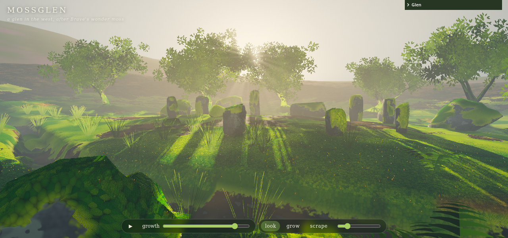

# Mossglen

A moss-covered Scottish glen in three.js: an old upright piano left in the middle of it, a recumbent stone circle on a knoll above a peaty burn, old oaks with buttress roots, boulders and a fallen bough, ferns and rushes, under four kinds of Scottish light. Moss grows over all of it on a front you can scrub through, and you can paint it on or scrape it off by hand. Press **✦ New forest** (or `n`) to sink this glen into the mere and conjure another. A new seed picks a kind of place (a stone circle on a knoll, an Icelandic lava field of moss pillows, a boulder-choked oakwood like Wistman's Wood, or a moss garden with stepping stones), rolls its hills, the burn's course and how lumpy the ground is, lays out its stones and oaks, and picks a light. The land rises from the middle outward on a glowing front in about a second and the moss floods in over a few seconds. Open `index.html` from any static server (three.js comes from unpkg via an import map), for example `python3 -m http.server` in `vibes/` and then `/mossglen/`. It installs as a PWA and works offline after the first visit.

## Using it

The bottom bar, left to right:

- **✦ New forest**, as above.
- **Play** and the growth slider: the moss creeps out from the burn banks over the wet ground and the hummocks, then up the stones and the trunks, to about 85% cover in about 10 s. The slider scrubs it.
- **Look / Grow / Scrape** (eye, sprout, scraper): in Grow, a stroke plants moss that swells up, matures and creeps outward through good habitat; Scrape strips it back to bare stone, soil or bark. While painting, a vertical slider above the tools sets the brush size.
- **Light**: Morning mist, Soft day, Golden evening, Gloaming; the light fades over from one to the next.
- **Sound** (speaker, `s`): the burn (louder near the water, with a babble of bubbles), the wind and the leaves in gusts, and birds (robin, wren, chaffinch, wood pigeon; a tawny owl in the gloaming), all synthesised.
- **Settings** (sliders icon): the hidden panel with Cover, Lush, Wet, light, breeze, creep, wisps, how painterly the distance is, and clear / bare / reset view.

Mouse: the left button paints (orbits in Look), the right button orbits, the wheel zooms. Touch: one finger paints, two fingers orbit and pinch. Keys: `n` new forest, `1` `2` `3` mode, `l` next light, space play, `[` `]` brush size, `h` hide the UI.

Zoom right in: within a few metres the moss turns into pincushion moss, pale domes bristling with tiny leaves. Far off it turns into dabs of paint.

URL options: `?seed=123` for a given glen, `?q=0|1|2` quality (phone, laptop, desktop; phones default to 0), `?grow=0.6`, `?cover=0.8`, `?lush=1`, `?wet=0.5`, `?light=2.5`, `?cam=x,y,z,tx,ty,tz`, `?nowisps`, `?pause`.

## How it works

- `world.js`: the height field, shaped by a seed and its kind of place (`setTerrainSeed`; seed 5 is the hand-tuned glen), with the rise shared by every vertex shader for the new-forest reveal, (knoll, hills, hummocks and the burn's channel), the warped-grid ground, the water (peaty, flowing normals, Fresnel sky, foam), the ring of hills and the sky dome with drifting cloud.
- `props.js`: per kind of place, stone circles, lava blocks, granite boulders or stepping stones and set stones, oaks kept out of the view line; stones are icospheres eroded by noise and cut by bevelled fracture planes; oaks are recursive tubes with buttress roots that return the spots their leaves hang from.
- `growth.js`: every mossable vertex (ground, stone, bark) gets a habitat (moisture by the burn, shade under the oaks, patch noise, upward faces, the foot of trunks) and an arrival time: a Dijkstra shortest path over the mesh from seeds on the banks, dearer through poor habitat, up props and uphill. A vertex is mossy once Growth passes its arrival time and Cover admits its habitat, so the front follows water and shade the way real moss does. Painting is per-vertex state (painted, scraped, maturity) in an RGBA8 texture the shaders read with `texelFetch`; painted moss creeps to neighbours over the mesh's adjacency.
- `moss.js`: near detail is pincushion moss (Leucobryum): instanced domes, each squashed and bristling with short stiff pale leaves over a stippled velvet, placed on the mossy vertices within a few metres of the camera, nearest first, refilled only when the camera moves and faded in by distance. Far off, the surface paints the moss in big dabs of chartreuse, olive, ochre and deep green. The surface shader puts soil, lichened schist or bark under a ragged moss edge, with cushions (domes on a jittered grid) for colour, relief and occlusion. Shells (instanced layers of the same mesh) give the pile; they thin out with distance and are cut inside each cushion's dome, so cushions part with dark seams. Sporophytes (setae with nodding capsules) stand on mature moss near the camera, never thinner than half a pixel.
- `props.js` also sets the piano down a little askew in the middle: the case is `piano_case.glb` from The Mechanical Pianist, the 88 keys are built here at its measurements, a few of them stuck down. Its parts are mossable like the stones (lacquer, brass, ivory, ebony, felt), with moss on the tops and ledges and the lacquer sides mostly bare.
- `audio.js`: Web Audio synthesis of the burn, the wind and the birds, through a generated reverb.
- `flora.js`: ferns whose fiddleheads unroll as the moss arrives, rushes, oak-leaf cards (alpha to coverage under MSAA), motes in the light and will-o'-the-wisps that light the moss in the gloaming.
- `post.js`: an MSAA half-float scene target whose alpha holds each pixel's distance (0 for the sky); a Kuwahara filter whose footprint grows with that distance, so far things flatten into crisp-edged dabs of colour while the near moss stays sharp, and a faint canvas grain; light shafts at half resolution from the sky behind the canopy, two-level bloom, then exposure, ACES, saturation, a cool shade / warm light split, vignette and grain.
- `glsl.js`: shared uniforms and GLSL: noise, wrap and translucent lighting, PCF sun shadow, height fog with sun scatter, the moss state.

Performance: three quality tiers (terrain and prop detail, shell layers and distance, sporophyte, fern and leaf counts, shadow size and taps, MSAA, wisp lights), an adaptive render scale between 0.5 and 1 that holds 60 fps (30 on phones), a shadow map rendered only when the light changes, and one draw call each for ground, stones and every kind of foliage. WebGL2 GLSL rather than TSL, so it runs on phones without WebGPU.

## Test

`node smoke.js` (zero deps, Playwright's Chromium with SwiftShader) checks that it loads without shader errors, renders, that coverage rises with Growth and Cover, that stones moss after the wet ground, that paint grows and creeps and scrape strips it, and that the phone tier renders. `ONLY=shots node smoke.js` just writes the `shot_*.png` screenshots. It is slow (several minutes) on a software renderer.

## Credits

The piano case (`piano_case.glb`) is from [The Mechanical Pianist](https://github.com/csimpkins22/mechanical-pianist) by csimpkins22, modelled in Blender by script. That repository doesn't state a licence; ask its author before publishing this sketch anywhere public.
