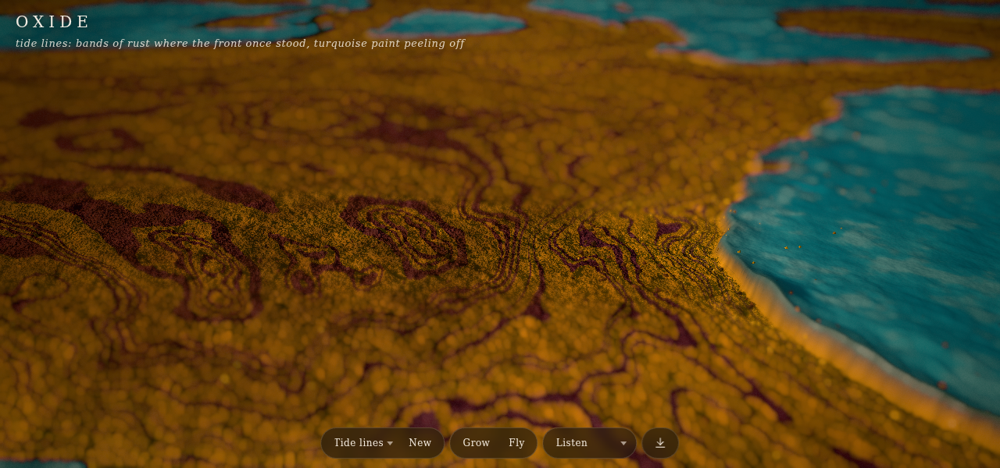
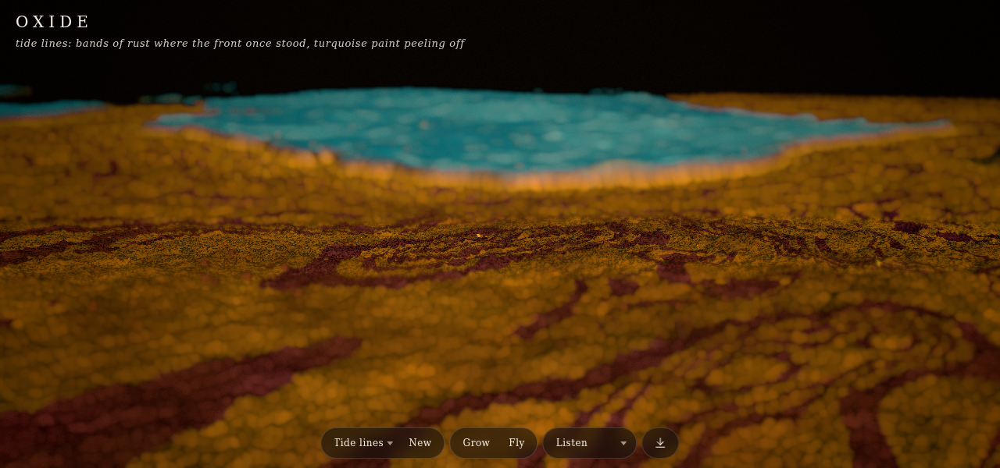
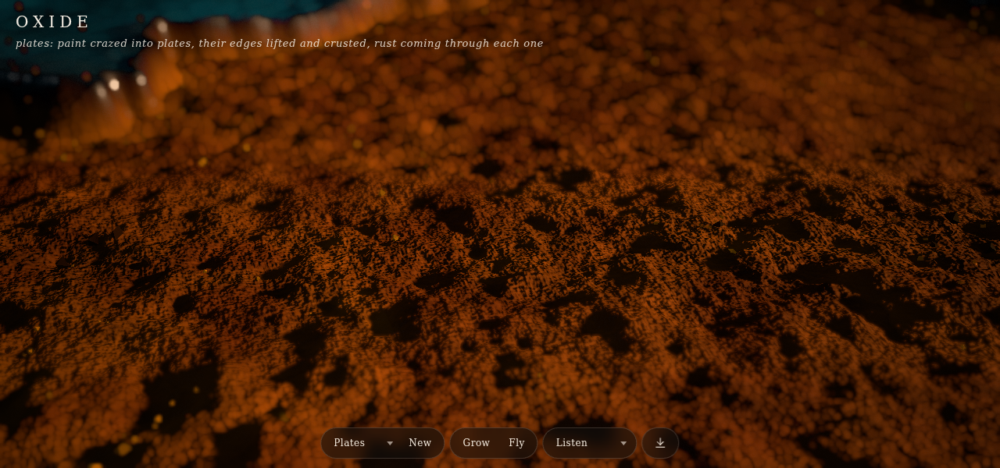
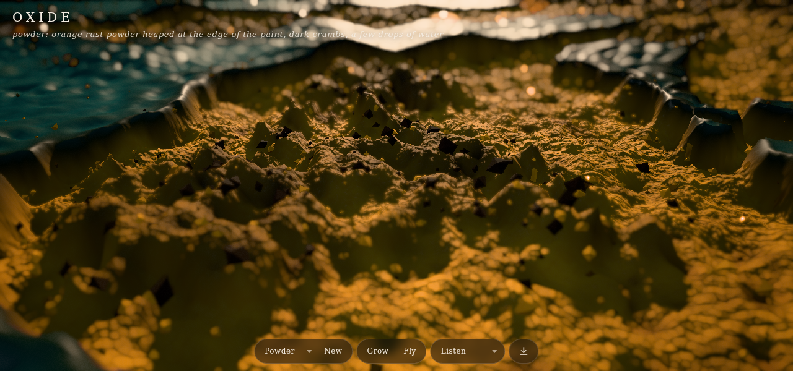
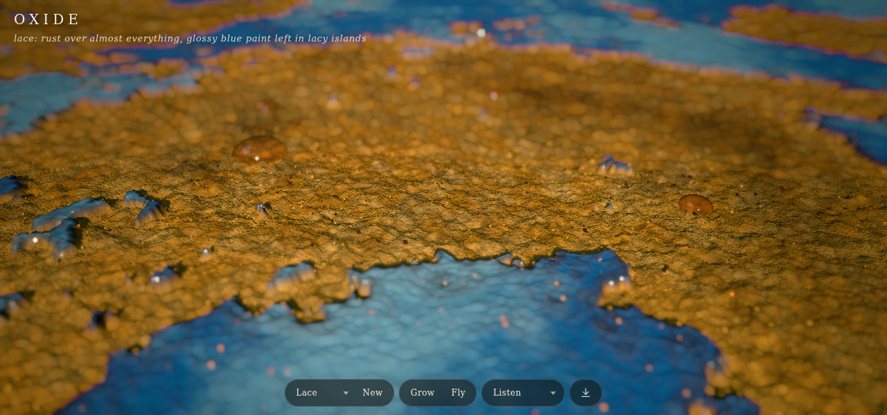
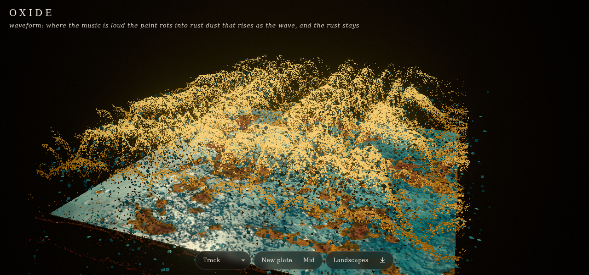

# Oxide

Codevember: Rust, a third take. Close-up landscapes of rust on old turquoise paint, a few centimetres of steel seen as if through a macro lens: tide lines where the rust front once stood, paint crazed into plates, orange powder heaped at the paint's edge, glossy paint left in lacy islands. The surface is raymarched a ray per pixel, so its detail follows the screen and it runs to the horizon; leave it and the camera glides over it like a lunar orbiter. three.js r187 WebGPU, TSL shaders and compute, offline PWA.

## Waveform

[`wave.html`](wave.html) is a classic 3D audio waveform on a 12 cm turquoise plate. Where the music is loud, the paint rots into rust dust that rises as the wave: the spectrum is mirrored left and right from the middle, the newest sound is at the back, and every eighth row of sound is a ridge line of dust that scrolls toward you. The dust glows brighter the higher it rides. The rust each loud pass eats into the paint stays, so the plate keeps a rust picture of the song.

- **Sound** (`l` or space): the built-in track, the microphone or an audio file. **New plate** (`n`) starts over on bare paint. **Low / Mid / High** (`a`) sets how high the wave rises.
- URL options: `res=` (plate field, 512 or 256 on phones), `dust=` (grains, 160000 or 50000 on phones), `amp=`, `seed=`.
- How it works (`wave.js`): the spectrum goes into a ring texture, 64 bands by 256 rows at 30 rows a second, smoothed across bands and in time and with a gain for each band. A compute pass grows rust on the plate where the wave is high, faster on steel that is prone to it. A second pass moves the grains: each is born on the plate under the wave, flakes from paint and crumbs and powder from rust, springs to the wave's height on its ridge line, rides forward with the sound and crumbles when the sound drops away.

## Using it

- **Scene** (`p`, arrow keys): Tide lines, Plates, Powder, Lace. **New** (`n`) makes another piece of the same scene.
- **Grow** (`g`) lets the rust front move into the paint.
- **Fly** (`d`): when you leave the camera alone it glides over the surface at a slow, steady height, turning and banking a little. Drag to look around (that takes the camera back), tap to focus there.
- **Listen** (`l`): the built-in track, the microphone, or an audio file (or drop one on the page) moves the paint to the sound.
- Save a PNG with `s`; `h` hides the interface.

URL options: `scene=tide|plates|powder|lace`, `seed=`, `grow`, `still` (no flight), `res=` (field size in texels; 768, or 512 on phones), `dpr=` (pixel ratio, 1 by default), `scale=` (fixed render scale; it follows the frame rate otherwise), `nodof`.

## How it works

- **Field** (`field.js`): two TSL compute passes make the landscape in five nested square levels that follow the camera (1.6 to 25.6 cm across, 768 x 768 texels each), so detail is fine near the camera and the steel never ends.
  - The arrival pass stores when rust reaches each point: a domain-warped fractal noise, lace from a finer one, cracks of a cell network where the paint has crazed, corrosion pits as craters, all varied by regions about 10 cm across (more or less rust, crazing, lace, crust, a purple or ochre tint, waviness of the sheet).
  - The shape pass turns the distance to the front into relief and materials: paint that lifts and curls where rust undercuts it, plates dished between cracks, blisters, banded tide lines, crust and pits, powder at the front and dark clumps behind it.
- **Raymarch** (`surface.js`): a fullscreen pass marches each pixel's ray through the height textures (steps sized by height and distance, then bisection), shades it by hand (paint in two tones with chalky weathering, banded and mottled rust, glints, GGX sun with soft shadows marched toward it, a dark room in the reflections, clearcoat, cavities, fog) and writes depth, so instanced grains of powder, crumbs and drops of water sit in it and the depth of field reads it.
- **Speed**: the scene renders at a scale that drops when frames run slower than 40 fps and rises above 57; the grade and film grain go on top at full size.

`node smoke.js` checks each scene renders with paint and rust in frame, the flight glides and stays above the ground, Listen moves the paint, growing takes paint, and the waveform raises dust and leaves rust (WebGPU on SwiftShader; `SHOTS=1` refreshes the screenshots here).
