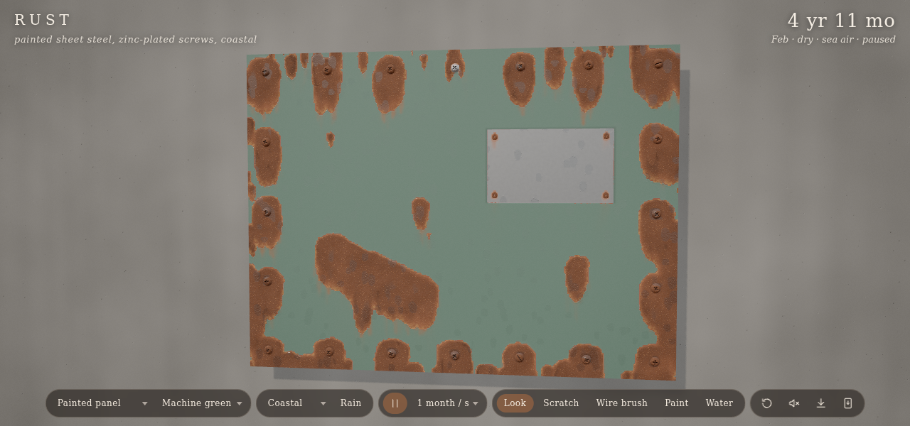
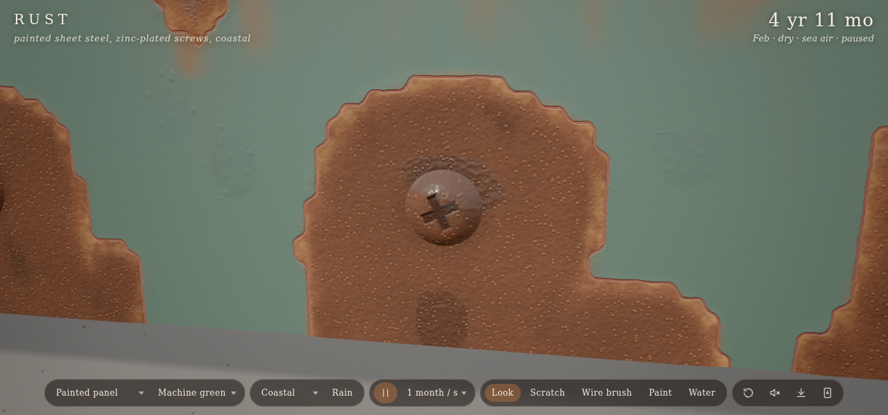
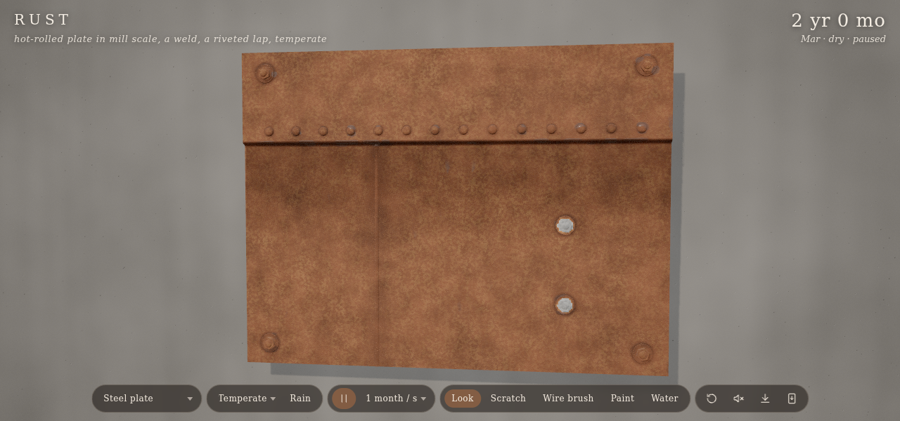
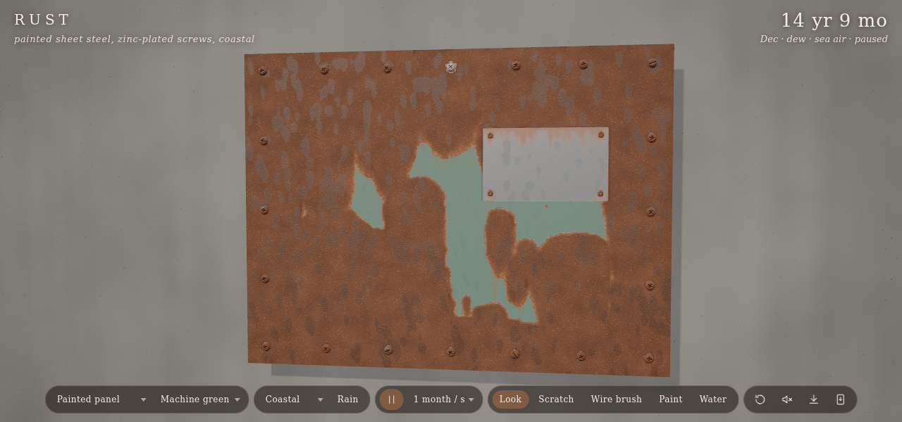

# Rust: letting the weather paint it

Codevember's prompt for the 11th was "rust". The idea was a piece of steel screwed to a wall outside: a painted panel, a hot-rolled plate or a sheet of galvanised roofing, aged by rain, dew and salt. I wanted it to rust the way real ones do, where the protection fails and where the water goes, instead of with a noise texture that fades in. It lives in [vibes/rust](./).

## Where rust starts

Painted steel doesn't rust all over. It rusts where the paint is broken: at a screw that cut through it, at a sheared edge, at a scratch. From there it works under the paint. The rust takes up more room than the steel it came from, so it lifts the paint into a blister, the blister cracks, and the paint flakes away from a ring that keeps growing. Gravity matters too. Water sits on top of a screw head and runs down from it, so the undercut grows faster downward and an orange tongue forms under each screw.

The simulation is a grid of cells over the sheet, stepped by three.js TSL compute shaders. Each cell has its water, the iron dissolved in that water, the stain left behind, its rust, its coating, how far rust has undercut the coating, and how much metal is gone. A cell's paint is undercut from rusty neighbours, with the neighbour above weighted most, and each cell flakes at its own threshold. That's enough to give ragged edges that grow downhill.

## Following the water

Most of the look comes from water. Each cell holds a small amount before it runs: a thin film on smooth paint, more on rust (rust soaks it up), and a lot in a crevice under a screw head or in a lap seam. Above that, water flows down the sheet's slope with a small random sideways lean per cell, so it gathers into rivulets. It evaporates more slowly in crevices and in thick rust, which is why those places stay wet and rust fastest.

Water running over rust picks up iron. Where it dries, it leaves the iron as an orange stain. That's what draws the faint streaks below every screw, even on paint that is still sound.

## Weather and materials

The clock runs from an hour a second up to a year a second. A weather model draws showers, dew on cool nights, warmth by season and salt for each climate. At fast speeds a frame can cover a month, which would leave the sheet wet all the time, so each frame is randomly wet or dry in proportion to how much it rained. Over many frames that comes out right.

The materials behave differently:

- Zinc corrodes first and keeps protecting the steel next to it until it is used up, so the galvanised sheet stays grey for years and then goes at the cut edges and screw holes.
- Mill scale on the hot-rolled plate cracks and lets rust through in patches. The steel beside the weld rusts faster.
- The one stainless screw on the panel doesn't rust, but the steel around it does, faster than anywhere else.
- Aluminium and rubber hold water against the steel next to them.

## Drawing it

The sim bakes into two half-float textures each frame, and one `MeshPhysicalNodeMaterial` builds the surface from them in layers: bare metal by material, primer at the edges of chipped paint, paint, rust graded from fresh orange to dark old scale with lighter flakes, stain, darkening in crevices, water as clearcoat with beads on surfaces that shed it, and holes cut with alpha test where the metal is gone. The relief (paint thickness, blisters, crust, pits) is one height, and the normal comes from its screen-space derivatives. The screws are lathe meshes, and their Phillips recesses are drawn in the shader.

You can take part. Scratch through the paint and come back a year later to find a rust line with a tongue below it. Wire-brush a patch back to steel. Paint over rust and watch it lift through the new coat, since paint over rust doesn't stop it.

