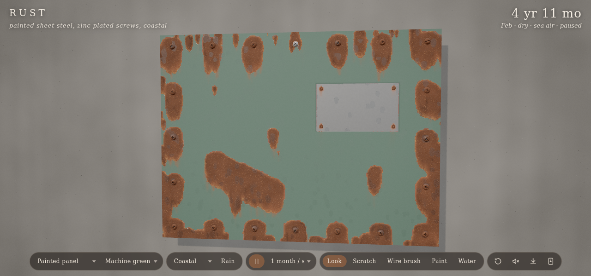
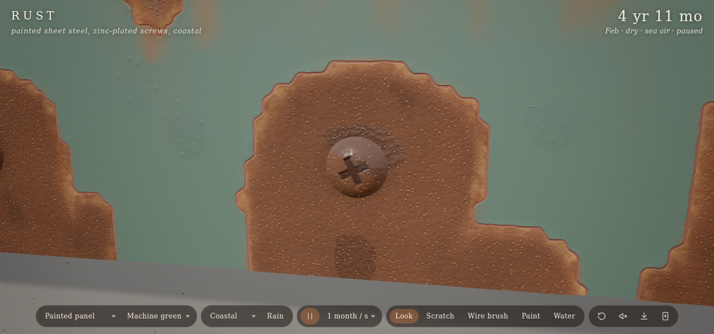
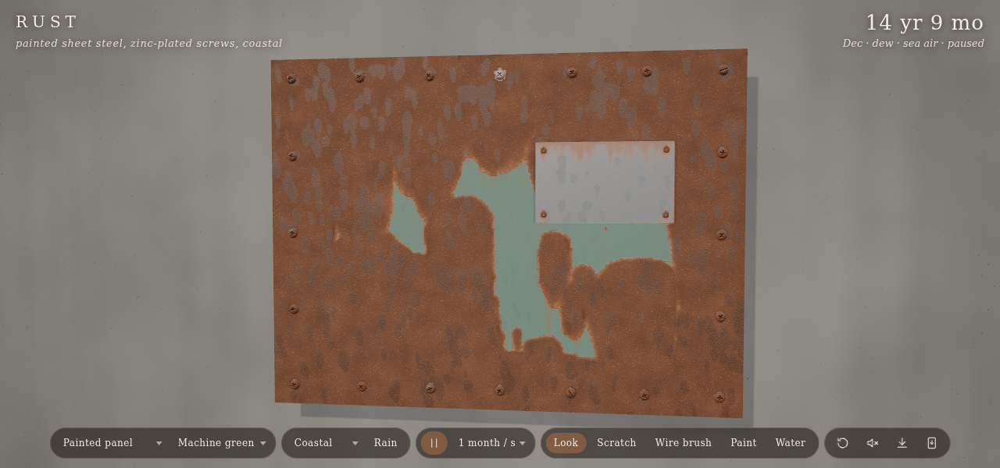
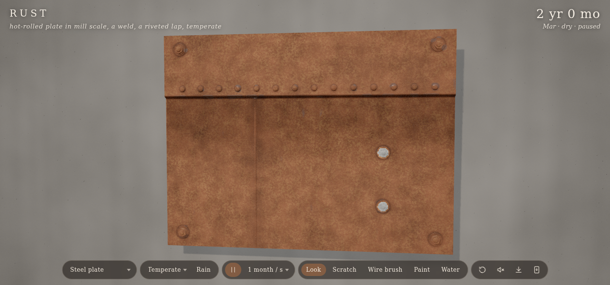
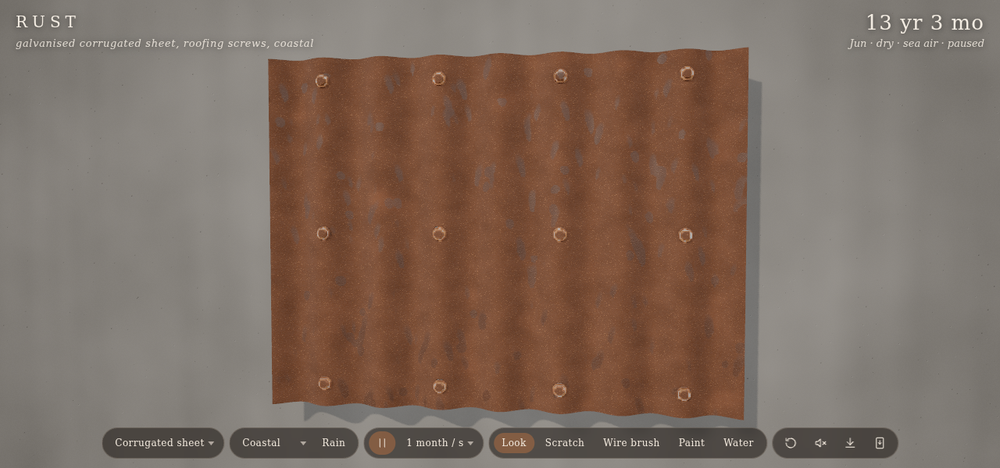

# Rust

Codevember: Rust. A steel sheet bolted to a wall outside, aged hour by hour in a climate you pick until it is years old. Rust starts where the protection is broken (screw heads, cut edges, scratches), creeps under the paint until it blisters and flakes, follows the water that runs down from every screw, and leaves orange stain where that water dries. Scratch it, wire-brush it back to bare metal, paint over it or wet it, and watch it come back. three.js r187 WebGPU, TSL shaders and compute, offline PWA.

## Using it

- **Piece** (`p`):
  - Painted panel: sheet steel with zinc-plated Phillips screws, two plain steel screws, one stainless one, and an aluminium rating plate held on with pop rivets.
  - Steel plate: hot-rolled in mill scale, with a weld seam, a riveted lap and hex bolts.
  - Corrugated sheet: galvanised, held by roofing screws on rubber washers.
- **Paint**: the panel's colour (machine green, signal red, gentian blue, cream, battleship grey).
- **Climate** (`c`): temperate, coastal (salt, the worst), tropical (warm and wet), dry. Each sets how often it rains and for how long, dew, temperature and salt.
- **Rain** (`w`) starts a shower now.
- **Speed** (`[` `]`): 1 hour, day, week, month or year a second. Pause with space.
- **Tools** (`1` to `5`, drag on the sheet):
  - Look orbits.
  - Scratch cuts through the coating to bare steel.
  - Wire brush takes off rust, flakes and loose paint.
  - Paint lays a fresh coat (it doesn't stop what is already under it).
  - Water wets the sheet so you can watch it run.
- Double-click flies the camera to a spot. Restart is `r`, sound is `m`, save a PNG is `s`, and `h` hides the interface.

URL options: `piece=panel|plate|corrugated`, `paint=green|red|blue|cream|grey`, `climate=temperate|coastal|tropical|dry`, `speed=0..4`, `seed=`, `age=` (years to fast-forward on load), `res=` (sim width in cells; 512, or 384 on phones), `tool=`, `paused`.

## How it works

- **Simulation** (`sim.js`): a grid of cells over the sheet, about 512 by 384, stepped by TSL compute shaders. Each cell carries:
  - its water, the dissolved iron in that water, and the stain the water left behind;
  - its rust, its coating (paint or zinc), how far rust has undercut that coating, and the metal lost;
  - what it is: material, crevice, susceptibility, edge, and a small lean and threshold so the rivulets and flakes differ cell to cell.
- **Water** runs downhill once a cell holds more than it can keep. Smooth paint holds a thin film, rust soaks more up, and a crevice (under a screw head, in a lap seam) holds the most. The flow is a pipe model over the sheet's slope with a random sideways lean, so drops make rivulets rather than sheets. Water evaporates more slowly in crevices and thick rust. Iron dissolved from rust travels with the water and settles as stain where it dries, which is what draws the streaks under the screws.
- **Chemistry**: time of wetness (water, rain on the whole sheet, dew) times warmth and salt drives everything.
  - Bare wet steel rusts, slowing as the crust thickens, and loses metal faster in pits and crevices. Holes open where enough is lost.
  - Paint is undercut from rust next to it, mostly from above, since water runs down. It blisters, then flakes off past each cell's own threshold.
  - Zinc corrodes first, more at cut edges and in salt, and keeps protecting bare steel near it until it is used up.
  - Stainless, aluminium and rubber don't rust. They hold water against the steel around them, and the steel by the stainless screw rusts faster.
- **Weather** (`weather.js`): hourly showers drawn from each climate's rain frequency and length, plus dew on cool nights, warmth by season and salt. At fast speeds each frame is randomly wet or dry in proportion to the rain, so the sheet isn't wet all the time.
- **Surface** (`surface.js`): one `MeshPhysicalNodeMaterial` reads the sim's baked textures and stacks the layers: bare metal by material (sheet steel, mill scale, zinc spangle, stainless, aluminium), primer at the edge of chipped paint, paint, a ramp of rust colours from fresh orange to dark old scale, stain, darkening in crevices, and water as clearcoat with beads. Holes are cut with alpha test. The normal comes from the layered height (paint thickness, blisters, rust crust, pits) by a screen-space surface gradient. Screw recesses (Phillips, slot, pop rivet) are drawn in the shader.
- **Scene** (`main.js`, `piece.js`): the sheet, its edges and back, merged lathe meshes for the hardware, a concrete wall, an outdoor sky as the environment, sun and hemisphere light with shadows, instanced rain streaks, vignette and grain.
- **Sound** (`audio.js`): procedural rain, drips, tool scrapes and a crackle as flakes let go.

## Test

`node smoke.js` loads the app in headless Chromium (WebGPU on SwiftShader, `?offscreen`) and checks:

- each piece loads and renders with no errors;
- scratch, brush, paint and water work;
- rain runs down and dries;
- paint is undercut and stain forms below the screws;
- five coastal years take some paint but not all;
- the plate rusts, and warmer climates rust faster;
- zinc still protects at a year, and there is rust at 13.

Shots go to `/tmp/rust-shots`, and `SHOTS=1` copies the ones above into this folder.
